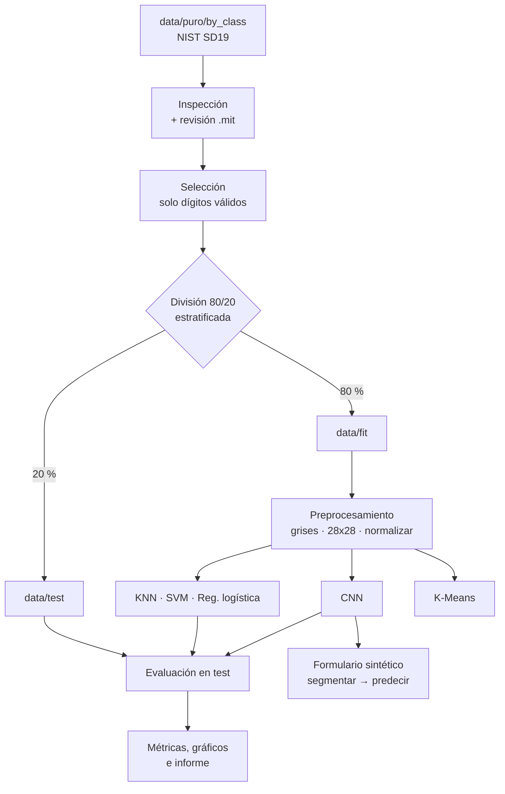
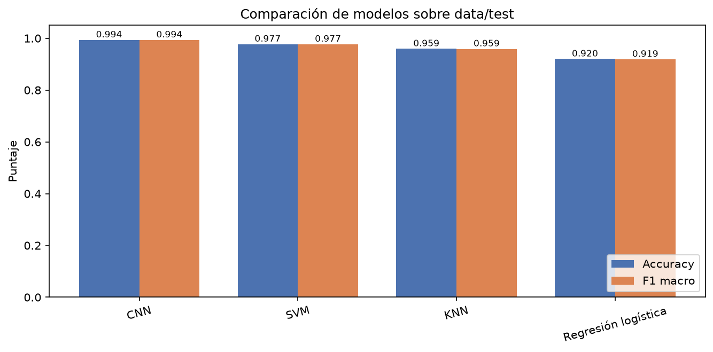
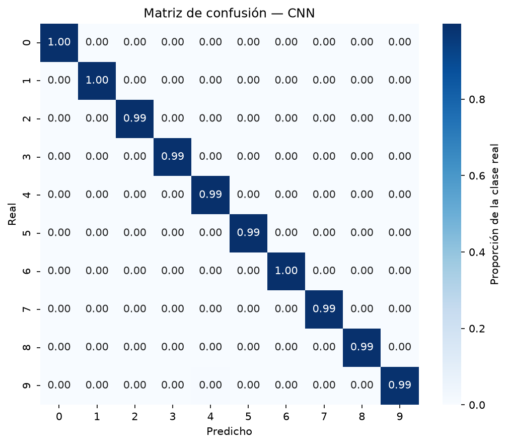
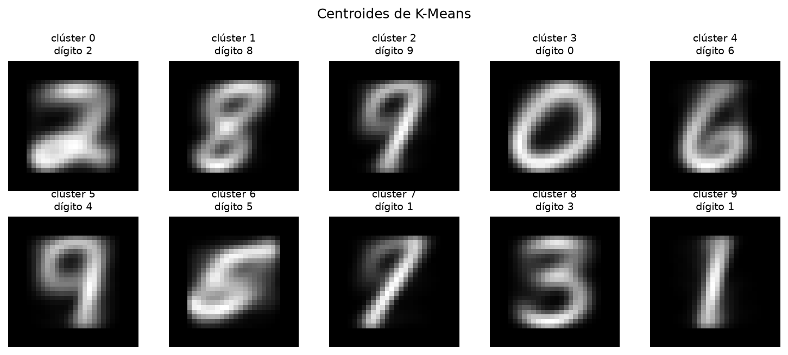
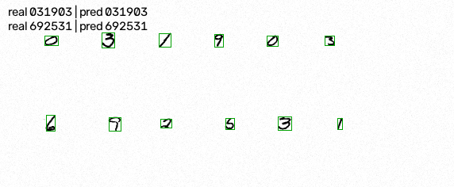

# Reconocimiento de dígitos manuscritos — TecnoForms

Sistema de *machine learning* y visión computacional que reconoce dígitos escritos a mano
para automatizar el procesamiento de formularios físicos en educación y finanzas. El
proyecto inspecciona y limpia **NIST Special Database 19**, entrena una **CNN** como
modelo principal y la compara contra **KNN, SVM y regresión logística**, explora los
dígitos con **K-Means** y demuestra el flujo completo leyendo un **formulario sintético**
(de imagen a cadena de dígitos).

## Funcionalidades

- Inspección del dataset crudo, incluida la revisión documentada de los archivos `.mit`.
- Selección de solo dígitos válidos, con trazo y sin duplicados exactos.
- División estratificada **80 / 20** en `data/fit` y `data/test` con manifiesto de trazabilidad.
- Preprocesamiento: escala de grises, inversión de fondo, recorte, 28×28 y normalización.
- Segmentación de dígitos por componentes conectados con orden de lectura.
- **CNN** convolucional con capas `Conv2D`, `BatchNormalization`, `MaxPooling2D`, `Dropout`.
- Comparación con **KNN**, **SVM (RBF)** y **regresión logística**.
- **K-Means** no supervisado con ARI, NMI, pureza y centroides visualizados.
- Entrenamiento con **validación cruzada estratificada** y búsqueda de hiperparámetros.
- Evaluación con matriz de confusión, precision, recall, F1 y tiempos.
- Galerías de aciertos y errores, curvas de entrenamiento y comparación de modelos.
- Lectura de formularios sintéticos con acierto por dígito y por campo.

## Diagrama del proyecto



## Arquitectura

```text
.
├── main.py                     # Orquesta las etapas; sin lógica de negocio
├── requirements.txt            # Dependencias con versiones fijadas
├── src/
│   ├── config.py               # Rutas, semilla, tamaños y presupuestos de cómputo
│   ├── utils.py                # Logging, semillas, JSON y hashes
│   ├── datos/
│   │   ├── inspeccion.py       # Recorre by_class y revisa los .mit
│   │   ├── seleccion.py        # Filtra solo dígitos válidos, con trazo y sin duplicados
│   │   ├── division.py         # Split 80/20 estratificado a data/fit y data/test
│   │   └── cargador.py         # Imágenes → arrays con caché .npz
│   ├── imagenes/
│   │   ├── preprocesamiento.py # Grises, recorte, 28×28, normalización
│   │   └── segmentacion.py     # Componentes conectados y orden de lectura
│   ├── modelos/
│   │   ├── clasicos.py         # KNN, SVM y regresión logística
│   │   ├── clustering.py       # K-Means, ARI/NMI y pureza
│   │   └── cnn.py              # Arquitectura de la CNN
│   ├── entrenamiento.py        # Fit, validación cruzada e hiperparámetros
│   ├── evaluacion/
│   │   ├── metricas.py         # Matriz de confusión, P/R/F1 y comparación
│   │   └── visualizacion.py    # Curvas, matrices, galerías y centroides
│   └── inferencia.py           # Formulario sintético de punta a punta
├── tests/                      # 13 pruebas: selección, división, preprocesamiento,
│                               #   segmentación y logging
├── data/                       # Datos crudos (solo lectura), particiones y caché
├── models/                     # Modelos entrenados (no se versiona)
├── logs/                       # pipeline.log de cada corrida (no se versiona)
└── reports/                    # figures/, metrics/, arquitectura_cnn.txt e informe.md
```

## Requisitos previos

- **Python 3.11–3.13**, probado con CPython 3.12.15. TensorFlow 2.21 publica *wheels*
  solo hasta CPython 3.13, y `pandas`, `pillow`, `scikit-learn` y `matplotlib` exigen 3.11
  o superior: 3.10 y 3.14 quedan fuera de la ventana. Si tu sistema trae 3.14, instalá 3.12
  o usá un intérprete standalone.
- **~1,8 GB** de disco adicionales al dataset crudo: `data/fit` + `data/test` ≈ 1,6 GB,
  caché de arrays `.npz` ≈ 97 MB y modelos ≈ 19 MB.
- Dataset **NIST Special Database 19** (`by_class.zip`) desde
  [nist.gov/srd/nist-special-database-19](https://www.nist.gov/srd/nist-special-database-19).
  Extraerlo de modo que exista `data/puro/by_class/` con las carpetas `30`–`39` (dígitos,
  código ASCII en hexadecimal), `41`–`5a` y `61`–`7a` (letras, se ignoran).

`data/puro/` es la **única** entrada que no se puede regenerar. Todo lo demás
(`manifest.csv`, `fit`, `test`, `processed`, `models`, `logs`, `reports/metrics`,
`reports/figures`) se reconstruye corriendo el script.

## Instalación y ejecución

```bash
# Linux / macOS
python3.12 -m venv .venv
source .venv/bin/activate
pip install -r requirements.txt
```

```powershell
# Windows (PowerShell)
py -3.12 -m venv .venv
.venv\Scripts\activate
pip install -r requirements.txt
```

```bash
python main.py                         # pipeline completo (~1 h en CPU)
python main.py --etapas division cnn    # solo algunas etapas
python main.py --rapido                 # prueba de humo (2k muestras, 1 época)
pytest                                  # 13 pruebas, ~2 s, no tocan TensorFlow
```

Etapas disponibles: `inspeccion`, `seleccion`, `division`, `clasicos`, `kmeans`, `cnn`,
`evaluacion`, `inferencia`. Cada una lee sus entradas de disco y escribe sus salidas, así
que se pueden ejecutar por separado respetando las dependencias: `division` necesita el
manifiesto que genera `seleccion`, y `clasicos`, `kmeans` y `cnn` necesitan `data/fit` y
`data/test`. `division` borra y recrea esas dos carpetas en cada corrida.

La salida de cada etapa va a la consola y además a `logs/pipeline.log`, que se abre en modo
*append* y conserva las corridas anteriores. Los artefactos de `reports/` en cambio se
sobrescriben: cada corrida reemplaza métricas y figuras.

Banderas útiles: `--muestras-cnn N` y `--epocas N` para acotar el costo del entrenamiento.

## Resultados

Corrida completa con semilla 42, del **23 de octubre de 2026**. Todos los números provienen
de `reports/metrics/`. El análisis detallado está en [`reports/informe.md`](reports/informe.md).

> Volver a correr el pipeline sobrescribe `reports/metrics/` y `reports/figures/`. Como
> TensorFlow en CPU no es determinista bit a bit, los decimales de esta tabla pueden variar
> levemente entre corridas; el orden de los modelos y las conclusiones no cambian.

**Conjunto de prueba:** 80 595 imágenes (20 % del dataset, nunca usadas en entrenamiento).

| Modelo | Accuracy | Precision macro | Recall macro | F1 macro | Entrenamiento | Inferencia |
|---|---:|---:|---:|---:|---:|---:|
| **CNN** | **0.9938** | **0.9938** | **0.9938** | **0.9938** | 437 s | 0.078 ms/img |
| SVM (RBF) | 0.9773 | 0.9771 | 0.9770 | 0.9771 | 7 s | 0.141 ms/img |
| KNN (k=3) | 0.9593 | 0.9598 | 0.9587 | 0.9590 | 3 s | 0.012 ms/img |
| Regresión logística | 0.9200 | 0.9189 | 0.9187 | 0.9188 | 22 s | 0.001 ms/img |

Submuestras de entrenamiento: 10 000 imágenes para KNN, SVM y regresión logística;
60 000 para la CNN. Los cuatro se evalúan sobre el **mismo test completo**.



**Cómo leerlo, en simple:** de cada 10 000 dígitos nuevos, la CNN se equivoca en unos 62;
el SVM, en 227; el KNN, en 407; la regresión logística, en 800. La CNN comete poco más de
un cuarto de los errores del SVM (500 frente a 1 830), que a su vez es un competidor serio
y barato de entrenar.



**Dónde falla la CNN.** Los errores no son aleatorios: se concentran en parejas de dígitos
que se parecen de verdad, y las mismas parejas aparecen en los cuatro modelos:

| Real → predicho | Casos (CNN) | % de la clase |
|---|---:|---:|
| 9 → 7 | 31 | 0.39 % |
| 9 → 4 | 30 | 0.38 % |
| 5 → 3 | 19 | 0.26 % |
| 3 → 2 | 17 | 0.21 % |
| 7 → 1 | 16 | 0.19 % |

Un 9 con el lazo abierto parece un 7; un 5 con el trazo superior corto parece un 3. Son
ambigüedades de la escritura, no fallas del modelo: el mismo par 9→7 le cuesta 158 casos
al KNN.

**K-Means** (20 000 imágenes, k=10): ARI 0.361, NMI 0.473, pureza global 0.569. Los
clústeres más puros son el 2 (88 %) y el 0 (86 %); los más mezclados agrupan 4 y 9. El
algoritmo incluso parte el dígito 1 en dos modos (con y sin base), lo que explica por qué
ciertas clases se confunden entre sí.



**Formularios sintéticos** (10 formularios, 20 campos, 120 dígitos): **85.83 %** de dígitos
correctos y **55 %** de campos exactos (11/20). El dato importante es de dónde viene el
error: en los 16 campos donde la segmentación conservó la cantidad de dígitos, el acierto
es del **94.79 %**. Los 4 campos restantes fallaron porque dos dígitos se tocaban o uno se
partió en dos recortes. **El clasificador no es el cuello de botella: la segmentación sí.**



Figuras restantes en `reports/figures/`: muestras del dataset, distribución de clases,
curvas de entrenamiento, galería de aciertos, galería de errores, las cuatro matrices de
confusión y los centroides de K-Means.

## Decisiones técnicas y limitaciones

- **CNN como modelo principal**: las capas convolucionales explotan la estructura
  espacial del trazo, algo que KNN y SVM pierden al aplanar la imagen a 784 píxeles.
  Aun así, los modelos clásicos son una referencia honesta y barata.
- **Submuestras declaradas**: KNN y SVM escalan mal con cientos de miles de imágenes, así
  que se entrenan con una submuestra estratificada de 10 000 imágenes de `data/fit`
  (columna `muestras` de `reports/metrics/hiperparametros.csv`); la CNN usa 60 000, de las
  cuales 54 000 entrenan y 6 000 validan (`reports/metrics/entrenamiento_cnn.json`). Las
  métricas de todos los modelos se calculan sobre **el mismo conjunto de prueba completo**.
- **Sin fuga por duplicados**: los duplicados exactos (`train_*` repite imágenes de
  `hsf_*`) se eliminan por hash **antes** de dividir.
- **Fuga por escritor (limitación conocida)**: la división es aleatoria por imagen y
  estratificada por dígito, como pide el enunciado. NIST SD19 identifica al escritor en
  los `.mit`, y un mismo escritor puede aportar imágenes a `fit` y a `test`; eso infla
  levemente la precisión frente a escritores nuevos. El manifiesto ya guarda el escritor
  (`fNNNN`) para poder migrar a `GroupShuffleSplit`.
- **Dígitos pegados (limitación de la segmentación)**: los componentes conectados unen
  dos dígitos que se tocan en una sola caja y separan un dígito partido en dos trazos. El
  proyecto recompone fragmentos verticales, pero no separa dígitos solapados.
- **Formularios reales**: la demo usa formularios sintéticos construidos con imágenes de
  `data/test`. Valida el diseño del pipeline, no reemplaza una prueba con escaneos reales.

## Créditos

- Dataset: **NIST Special Database 19 — NIST Handprinted Forms and Characters Database**,
  National Institute of Standards and Technology.
  <https://www.nist.gov/srd/nist-special-database-19>
- Librerías principales: TensorFlow/Keras, scikit-learn, OpenCV, NumPy, pandas,
  Matplotlib y Seaborn.
