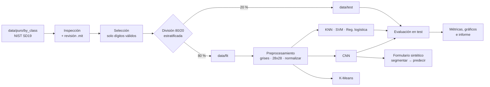

# Reconocimiento de dígitos manuscritos para TecnoForms

## Tema

**Reconocimiento de dígitos manuscritos con Machine Learning y visión computacional, aplicado a la clasificación automática de formularios escritos a mano**

---

## Contexto

La empresa **TecnoForms**, especializada en el desarrollo de soluciones tecnológicas para empresas, ha identificado una necesidad creciente de automatizar el procesamiento de formularios escritos a mano, especialmente en áreas como la **educación** y las **finanzas** (formularios de inscripción, pagos, solicitudes, etc.).

El principal desafío es el **reconocimiento de los dígitos manuscritos**: los formularios llegan en formato físico y deben procesarse automáticamente, extrayendo con precisión los dígitos que anotan los usuarios.

La empresa necesita diseñar y desarrollar una solución de aprendizaje automático que, usando técnicas de **Machine Learning** y **visión computacional**, identifique y clasifique con precisión dígitos escritos a mano.

---

## Mapa de requisitos: qué se pide y dónde se cumple

Esta tabla conecta los requisitos del enunciado original con los módulos del proyecto, para que nada quede sin cubrir.

| Requisito del enunciado | Dónde se cumple |
|-------------------------|-----------------|
| 2.1 Selección de algoritmos (red neuronal + comparar con KNN / SVM) | `src/modelos/cnn.py`, `src/modelos/clasicos.py` |
| 2.2 Preprocesamiento (normalización, escala de grises, segmentación) | `src/imagenes/preprocesamiento.py`, `src/imagenes/segmentacion.py` |
| 2.3 Diseño de la red neuronal (capas convolucionales) | `src/modelos/cnn.py` |
| 2.4 Entrenamiento, validación cruzada e hiperparámetros | `src/entrenamiento.py` |
| 2.5 Evaluación con conjunto de prueba y comparación | `src/evaluacion/metricas.py` |
| 3.1 Métricas (matriz de confusión, precision, recall, F1) | `src/evaluacion/metricas.py` → `reports/metrics/` |
| 3.2 Código fuente: regresión, K-Means, redes neuronales, preprocesamiento | `clasicos.py` (regresión logística), `clustering.py`, `cnn.py`, `preprocesamiento.py` |
| 3.3 Resultados visuales (predicciones vs. etiquetas reales) | `src/evaluacion/visualizacion.py` → `reports/figures/` |
| 3.4 Arquitectura de la red (capas, neuronas, activaciones, optimizador) | `reports/arquitectura_cnn.txt` + sección del informe |
| 3.5 Informe técnico | `reports/informe.md` |

> **Nota sobre "tipo de datos: ficticios" (requisito 3.2):** el entrenamiento y la evaluación usan datos **reales** (NIST SD19). Los datos ficticios se cubren con un **formulario sintético** generado por el propio proyecto a partir de dígitos de `data/test/`, que sirve para demostrar la segmentación y la lectura de punta a punta (requisito 6 y 13 más abajo).

---

## Requerimientos principales

La solución debe incluir:

* Inspección del dataset crudo (`data/puro/by_class`), incluyendo la **revisión de los archivos `.mit`** de cada subcarpeta.
* Selección automática de **lo bueno y necesario** de esa data (solo dígitos, imágenes válidas, sin duplicados).
* División **80 % / 20 %** estratificada en `data/fit/` y `data/test/`.
* Preprocesamiento de imágenes: escala de grises, normalización y segmentación de dígitos.
* Una **red neuronal convolucional (CNN)** como modelo principal.
* Modelos de comparación: **KNN**, **SVM** y **regresión logística**.
* **K-Means** como análisis no supervisado de los dígitos.
* Entrenamiento con **validación cruzada** y ajuste de **hiperparámetros**.
* Evaluación con conjunto de prueba: matriz de confusión, precision, recall y F1-score.
* Resultados visuales y un informe técnico.
* Proyecto modular con **scripts de responsabilidad única**, centralizados en `main.py`.
* `requirements.txt` y `README.md` completo.

---

## Fuente de datos

Los datos provienen de **NIST Special Database 19** (*NIST Handprinted Forms and Characters Database*):

[https://www.nist.gov/srd/nist-special-database-19](https://www.nist.gov/srd/nist-special-database-19)

Se descargó el directorio **`by_class`**, que agrupa los caracteres aislados por clase. La data cruda está en:

```text
data/puro/by_class/
```
- **SI NECEISTAS INFORMARTE DE LA DOCUMENTACIÓN OFICIAL PUEDES BUSCAR EN LA WEB.**

### Cómo está organizado `by_class` (a verificar, no asumir)

Cada subcarpeta de `by_class` corresponde a una clase, nombrada con el **código ASCII en hexadecimal** del carácter. Para este proyecto solo interesan los **dígitos**:

| Carpeta | Carácter | Carpeta | Carácter |
|---------|----------|---------|----------|
| `30` | `0` | `35` | `5` |
| `31` | `1` | `36` | `6` |
| `32` | `2` | `37` | `7` |
| `33` | `3` | `38` | `8` |
| `34` | `4` | `39` | `9` |

Las demás carpetas (letras mayúsculas `41`–`5a` y minúsculas `61`–`7a`) **no pertenecen al problema** y deben ignorarse, sin borrarlas.

Conversión de código hexadecimal a dígito:

```python
codigo = "35"
digito = int(codigo, 16) - 0x30   # 0x35 - 0x30 = 5
```

Dentro de cada carpeta de dígito, las imágenes están separadas por particiones (`hsf_*`) y, según el caso, hay archivos **`.mit`** junto a las imágenes.

> **Nota importante:** no se debe asumir el contenido ni el formato de los archivos `.mit`, ni la estructura exacta de subcarpetas, ni el tamaño de las imágenes, sin comprobarlos primero. La etapa 1 existe precisamente para eso (ver requisito 1). Si el `.mit` resulta útil (por ejemplo, para relacionar cada imagen con su clase o con metadatos), se documenta su estructura y se usa; si no, se justifica por qué se ignora.

Documentación oficial: [NIST Special Database 19](https://www.nist.gov/srd/nist-special-database-19).

### Flujo de los datos

```text
data/puro/by_class/        ← crudo, SOLO LECTURA (nunca se modifica)
        │
        ▼  inspección + selección (solo dígitos, válidas, sin duplicados)
        │
        ▼  división 80 / 20 estratificada por dígito
        │
   ┌────┴─────┐
   ▼          ▼
data/fit/   data/test/     ← carpetas por dígito: 0/ 1/ ... 9/
(80 %)      (20 %)
```

```text
data/
├── puro/
│   └── by_class/          # Data original de NIST (no se toca)
├── fit/                   # 80 % → entrenamiento y validación
│   ├── 0/ 1/ 2/ ... 9/    # una carpeta por dígito (ya en decimal)
├── test/                  # 20 % → solo para la evaluación final
│   ├── 0/ 1/ 2/ ... 9/
├── processed/             # Caché de arrays preprocesados (.npz), regenerable
└── manifest.csv           # Trazabilidad: ruta original, dígito, partición, hash
```

---

## Estructura del proyecto

El proyecto se organiza por **capas**: cada archivo agrupa **una sola responsabilidad**, cada carpeta de `src/` agrupa un tema (datos, imágenes, modelos, evaluación) y `main.py` es el **punto de entrada único** que ejecuta las etapas en orden. Así el proyecto puede crecer sin volverse un solo script gigante.

```text
tecnoforms-digitos/
├── main.py                        # Punto de entrada: orquesta las etapas
├── requirements.txt               # Dependencias con versiones fijadas
├── README.md                      # Instalación, ejecución, diagrama, resultados
├── .gitignore                     # .venv/, __pycache__/, data/, models/, etc.
├── data/                          # Ver "Flujo de los datos"
├── src/
│   ├── __init__.py
│   ├── config.py                  # Constantes: rutas, semilla, proporciones, tamaño de imagen
│   ├── utils.py                   # Logging, semilla global, helpers sin dominio
│   ├── datos/
│   │   ├── __init__.py
│   │   ├── inspeccion.py          # Recorre by_class y revisa .mit (req. 1)
│   │   ├── seleccion.py           # Filtra lo bueno y necesario (req. 2)
│   │   ├── division.py            # Split 80/20 → data/fit y data/test (req. 3)
│   │   └── cargador.py            # Carga imágenes a arrays con caché (req. 4)
│   ├── imagenes/
│   │   ├── __init__.py
│   │   ├── preprocesamiento.py    # Grises, normalización, recorte, 28x28 (req. 5)
│   │   └── segmentacion.py        # Separa dígitos de un formulario (req. 6)
│   ├── modelos/
│   │   ├── __init__.py
│   │   ├── clasicos.py            # KNN, SVM, regresión logística (req. 7)
│   │   ├── clustering.py          # K-Means (req. 8)
│   │   └── cnn.py                 # Arquitectura de la CNN (req. 9)
│   ├── entrenamiento.py           # Fit, validación cruzada, hiperparámetros (req. 10)
│   ├── evaluacion/
│   │   ├── __init__.py
│   │   ├── metricas.py            # Matriz de confusión, P/R/F1, comparación (req. 11)
│   │   └── visualizacion.py       # Gráficos y galería de predicciones (req. 12)
│   └── inferencia.py              # Lectura de un formulario sintético (req. 13)
├── tests/
│   ├── test_seleccion.py
│   ├── test_division.py
│   ├── test_preprocesamiento.py
│   └── test_segmentacion.py
├── models/                        # Modelos entrenados (.keras, .joblib) — no se versionan
└── reports/
    ├── figures/                   # Gráficos generados (PNG)
    ├── metrics/                   # JSON/CSV con métricas y reporte de inspección
    ├── arquitectura_cnn.txt       # model.summary() de la CNN
    └── informe.md                 # Informe técnico final
```

### Diseño de `main.py`

`main.py` **no contiene lógica de negocio**: solo importa funciones de `src/` y las llama en orden. Cada etapa **lee sus entradas del disco y escribe sus salidas al disco** (manifiesto, caché `.npz`, modelos guardados), por lo que:

* cada etapa se puede ejecutar de forma **independiente** (`--etapas division cnn`);
* si una etapa falla, no hay que repetir las anteriores;
* cada módulo se puede probar y reutilizar por separado.

Orden de ejecución:

| Paso | Etapa | Módulo | Qué hace |
|------|-------|--------|----------|
| 1 | `inspeccion` | `datos/inspeccion.py` | Recorre `by_class`, cuenta archivos por extensión y revisa los `.mit` |
| 2 | `seleccion` | `datos/seleccion.py` | Se queda solo con dígitos válidos, sin corruptos, vacíos ni duplicados |
| 3 | `division` | `datos/division.py` | Copia 80 % a `data/fit/` y 20 % a `data/test/` (estratificado) |
| 4 | `clasicos` | `modelos/clasicos.py` + `entrenamiento.py` | Entrena y valida KNN, SVM y regresión logística |
| 5 | `kmeans` | `modelos/clustering.py` | Agrupa los dígitos sin etiquetas y los compara con las etiquetas reales |
| 6 | `cnn` | `modelos/cnn.py` + `entrenamiento.py` | Entrena y valida la CNN, guarda el mejor modelo |
| 7 | `evaluacion` | `evaluacion/*` | Evalúa todo en `data/test/`, compara modelos y genera gráficos |
| 8 | `inferencia` | `inferencia.py` | Genera un formulario sintético, segmenta, clasifica y compara |

Esqueleto sugerido:

```python
"""Punto de entrada del proyecto: ejecuta cada etapa en orden."""
import argparse
import logging

from src import config, entrenamiento, inferencia, utils
from src.datos import division, inspeccion, seleccion
from src.evaluacion import metricas, visualizacion
from src.modelos import clasicos, clustering, cnn

logger = logging.getLogger("tecnoforms")

ETAPAS = ("inspeccion", "seleccion", "division", "clasicos",
          "kmeans", "cnn", "evaluacion", "inferencia")


def parsear_argumentos() -> argparse.Namespace:
    parser = argparse.ArgumentParser(description="Pipeline de reconocimiento de dígitos")
    parser.add_argument("--etapas", nargs="+", choices=ETAPAS, default=list(ETAPAS),
                        help="Etapas a ejecutar (por defecto, todas en orden)")
    parser.add_argument("--rapido", action="store_true",
                        help="Prueba de humo con una fracción pequeña de los datos")
    return parser.parse_args()


def main() -> None:
    args = parsear_argumentos()
    utils.configurar_logging()
    utils.fijar_semilla(config.SEED)
    total = len(args.etapas)

    for i, etapa in enumerate(args.etapas, start=1):
        logger.info("Etapa %d/%d: %s", i, total, etapa)
        if etapa == "inspeccion":
            inspeccion.generar_reporte(config.RAW_DIR, config.METRICS_DIR)
        elif etapa == "seleccion":
            seleccion.seleccionar(config.RAW_DIR, config.MANIFEST_PATH)
        elif etapa == "division":
            division.dividir(config.MANIFEST_PATH, config.FIT_DIR, config.TEST_DIR)
        elif etapa == "clasicos":
            entrenamiento.entrenar_clasicos(rapido=args.rapido)
        elif etapa == "kmeans":
            clustering.ejecutar()
        elif etapa == "cnn":
            entrenamiento.entrenar_cnn(rapido=args.rapido)
        elif etapa == "evaluacion":
            resultados = metricas.evaluar_todos()
            visualizacion.generar_todas(resultados)
        elif etapa == "inferencia":
            inferencia.demo_formulario()

    logger.info("Proceso completado. Reportes en %s", config.REPORTS_DIR)


if __name__ == "__main__":
    main()
```

> **Nota de buena práctica:** `if __name__ == "__main__":` evita que el código se ejecute al importar el archivo. Las constantes viven en `config.py` para no tener "números mágicos" repartidos por el proyecto.

```python
# src/config.py
from pathlib import Path

BASE_DIR = Path(__file__).resolve().parent.parent

# Rutas de datos
RAW_DIR = BASE_DIR / "data" / "puro" / "by_class"
FIT_DIR = BASE_DIR / "data" / "fit"
TEST_DIR = BASE_DIR / "data" / "test"
PROCESSED_DIR = BASE_DIR / "data" / "processed"
MANIFEST_PATH = BASE_DIR / "data" / "manifest.csv"

# Rutas de salida
MODELS_DIR = BASE_DIR / "models"
REPORTS_DIR = BASE_DIR / "reports"
FIGURES_DIR = REPORTS_DIR / "figures"
METRICS_DIR = REPORTS_DIR / "metrics"

# Dígitos: códigos hexadecimales de NIST (30 → '0' ... 39 → '9')
DIGIT_CODES = [f"{c:02x}" for c in range(0x30, 0x3A)]
CLASES = list(range(10))

# Reproducibilidad y división
SEED = 42
FIT_RATIO = 0.80          # 80 % → data/fit
TEST_RATIO = 0.20         # 20 % → data/test

# Imágenes
IMG_SIZE = 28             # tamaño final (estilo MNIST)
DIGIT_BOX = 20            # lado máximo del dígito dentro del lienzo de 28x28

# Entrenamiento
VAL_SPLIT = 0.10          # parte de data/fit reservada para validación de la CNN
CV_FOLDS = 5              # pliegues de validación cruzada
CLASSIC_SUBSAMPLE = 20_000  # muestras de fit para KNN/SVM (ver nota de costo)
```

---

## Requisitos funcionales

### 1. Inspección del dataset crudo y revisión de los `.mit`

**Módulo:** `src/datos/inspeccion.py`

Antes de usar cualquier dato, el proyecto debe **entender lo que realmente hay** en `data/puro/by_class/`. La etapa debe:

* Listar las subcarpetas de `by_class` e identificar cuáles son dígitos (`30`–`39`) y cuáles no.
* Contar archivos por **extensión** (`.png`, `.mit`, otros) en cada subcarpeta.
* Contar imágenes por dígito y calcular el **balance de clases**.
* Revisar los archivos **`.mit`**: tamaño, número por carpeta, y una vista de su contenido (primeros bytes o líneas) para decidir si son texto o binario.
* Verificar el **tamaño y modo** (escala de grises o color) de una muestra de imágenes.
* Guardar todo en `reports/metrics/inspeccion_dataset.json` para que el informe pueda citarlo.

Ejemplo simple (contar archivos por extensión en una carpeta):

```python
from collections import Counter
from pathlib import Path

carpeta = Path("data/puro/by_class/30")
extensiones = Counter(p.suffix.lower() for p in carpeta.rglob("*") if p.is_file())
print(extensiones)   # p. ej. Counter({'.png': ..., '.mit': ...})
```

Ejemplo más completo (revisar un `.mit` sin asumir su formato):

```python
from pathlib import Path


def vista_previa_mit(ruta: Path, n_bytes: int = 200) -> dict:
    """Describe un archivo .mit sin asumir que sea texto."""
    datos = ruta.read_bytes()[:n_bytes]
    try:
        contenido = datos.decode("utf-8")
        tipo = "texto"
    except UnicodeDecodeError:
        contenido = datos.hex(" ")
        tipo = "binario"
    return {
        "archivo": str(ruta),
        "tamano_bytes": ruta.stat().st_size,
        "tipo": tipo,
        "vista_previa": contenido,
    }
```

> **Decisión que sale de este paso:** con el reporte se define qué se usa y qué se ignora. El resultado (qué contienen los `.mit` y si se aprovechan) debe quedar escrito en el informe técnico. **No asumir** nada de los `.mit` antes de abrirlos.

Documentación oficial: [`pathlib`](https://docs.python.org/3/library/pathlib.html), [`collections.Counter`](https://docs.python.org/3/library/collections.html#collections.Counter).

### 2. Selección de lo bueno y necesario

**Módulo:** `src/datos/seleccion.py`

El agente debe **separar lo bueno y necesario** del crudo. Criterios mínimos:

* **Solo dígitos:** carpetas `30`–`39`. Todo lo demás se ignora.
* **Solo imágenes:** se descartan archivos que no sean imagen (por ejemplo, los `.mit`, tras haberlos revisado).
* **Imágenes legibles:** se descartan archivos corruptos o que no se puedan abrir.
* **Imágenes con trazo:** se descartan imágenes totalmente en blanco.
* **Sin duplicados exactos:** se detectan por *hash* del contenido (por ejemplo, SHA-1 o MD5 del archivo).
* **Trazabilidad:** cada decisión queda registrada en `data/manifest.csv` y se loguea cuántas imágenes se descartaron y por qué.

Estructura mínima del manifiesto:

| ruta_original | digito | hash | valida | motivo_descarte |
|---------------|--------|------|--------|-----------------|
| `data/puro/by_class/35/.../archivo.png` | 5 | `a1b2...` | `True` | |
| `data/puro/by_class/31/.../otro.png` | 1 | `c3d4...` | `False` | `corrupta` |

Ejemplo simple (hash de un archivo):

```python
import hashlib
from pathlib import Path


def hash_archivo(ruta: Path) -> str:
    return hashlib.md5(ruta.read_bytes()).hexdigest()
```

Ejemplo más completo (validar una imagen):

```python
import cv2
import numpy as np


def imagen_valida(ruta) -> tuple[bool, str]:
    img = cv2.imread(str(ruta), cv2.IMREAD_GRAYSCALE)
    if img is None:
        return False, "corrupta"
    if np.count_nonzero(img != img.max()) == 0:   # sin variación = sin trazo
        return False, "en_blanco"
    return True, ""
```

> **Nota:** los duplicados deben eliminarse **antes** de dividir en `fit` y `test`. Si la misma imagen cae en ambos conjuntos, el modelo "ya la vio" y la precisión de prueba queda inflada (*data leakage*).

> **Nota:** `data/puro/` es **de solo lectura**. La selección y la división **copian** archivos a `data/fit/` y `data/test/`; nunca mueven ni borran los originales.

Documentación oficial: [`hashlib`](https://docs.python.org/3/library/hashlib.html), [`cv2.imread`](https://docs.opencv.org/4.x/d4/da8/group__imgcodecs.html).

### 3. División 80 % / 20 % en `data/fit` y `data/test`

**Módulo:** `src/datos/division.py`

Las imágenes seleccionadas se reparten así:

* **80 %** → `data/fit/<dígito>/` (se usa para entrenar y validar).
* **20 %** → `data/test/<dígito>/` (se usa **una sola vez**, al final, para la evaluación).

Requisitos de la división:

* **Estratificada por dígito:** cada dígito conserva la misma proporción 80/20.
* **Reproducible:** semilla fija (`SEED`).
* **Disjunta:** ninguna imagen puede estar en ambos conjuntos.
* **Idempotente:** si se ejecuta dos veces, no duplica ni mezcla archivos (limpia y recrea, o detecta que ya existe).
* Las carpetas de salida se nombran en **decimal** (`0`–`9`), no en hexadecimal.

Ejemplo simple (la división en sí):

```python
from sklearn.model_selection import train_test_split

rutas_fit, rutas_test, y_fit, y_test = train_test_split(
    rutas, etiquetas,
    test_size=0.20,
    stratify=etiquetas,     # conserva la proporción de cada dígito
    random_state=42,        # reproducibilidad
)
```

Ejemplo más completo (copiar, registrar y verificar):

```python
import shutil
from pathlib import Path

import pandas as pd


def copiar_a_particion(df: pd.DataFrame, destino: Path) -> None:
    for fila in df.itertuples():
        carpeta = destino / str(fila.digito)
        carpeta.mkdir(parents=True, exist_ok=True)
        # nombre único: evita colisiones entre particiones hsf_* con el mismo nombre
        shutil.copy2(fila.ruta_original, carpeta / f"{fila.hash}.png")


# Verificación obligatoria tras dividir
assert set(df_fit["hash"]).isdisjoint(set(df_test["hash"])), "Hay fuga de datos"
assert abs(len(df_test) / (len(df_fit) + len(df_test)) - 0.20) < 0.01
```

> **Nota importante (limitación a documentar):** una división aleatoria por imagen puede poner dígitos del **mismo escritor** en `fit` y en `test`. Eso es una forma sutil de fuga de información que suele inflar un poco la precisión frente a escritores nuevos. Se cumple el 80/20 pedido, pero esta limitación debe quedar en el informe. Si los archivos `.mit` o los nombres de las particiones (`hsf_*`) permiten agrupar por escritor o partición, se puede usar `GroupShuffleSplit` como mejora.

Documentación oficial: [`train_test_split`](https://scikit-learn.org/stable/modules/generated/sklearn.model_selection.train_test_split.html), [`GroupShuffleSplit`](https://scikit-learn.org/stable/modules/generated/sklearn.model_selection.GroupShuffleSplit.html), [`shutil.copy2`](https://docs.python.org/3/library/shutil.html#shutil.copy2).

### 4. Carga de imágenes

**Módulo:** `src/datos/cargador.py`

Debe cargar `data/fit/` y `data/test/` a arrays de NumPy listos para los modelos:

* `X` de forma `(n_imágenes, 28, 28)` o `(n_imágenes, 28, 28, 1)` para la CNN, y `(n_imágenes, 784)` para los modelos clásicos.
* `y` con el dígito (0–9) de cada imagen, tomado del **nombre de la carpeta**.
* **Caché** en `data/processed/*.npz` para no repetir el preprocesamiento en cada ejecución.
* Uso de la **misma función de preprocesamiento** que usará la inferencia.

```python
import numpy as np

X = np.zeros((n, 28, 28), dtype="float32")
y = np.zeros(n, dtype="int64")
np.savez_compressed("data/processed/fit.npz", X=X, y=y)     # guardar
datos = np.load("data/processed/fit.npz")                   # cargar
X, y = datos["X"], datos["y"]
```

> **Nota:** la etiqueta sale de la **carpeta**, no del nombre del archivo. Es más robusto y evita errores de parseo.

Documentación oficial: [`numpy.savez_compressed`](https://numpy.org/doc/stable/reference/generated/numpy.savez_compressed.html), [`keras.utils.image_dataset_from_directory`](https://keras.io/api/data_loading/image/) (alternativa para cargar directo desde carpetas).

### 5. Preprocesamiento de imágenes

**Módulo:** `src/imagenes/preprocesamiento.py`

Pasos que debe aplicar, en este orden:

1. **Conversión a escala de grises** (un solo canal).
2. **Unificar el fondo:** que el trazo sea claro sobre fondo oscuro (estilo MNIST). Si el fondo es claro, se invierte la imagen.
3. **Binarización de apoyo (Otsu)** solo para localizar el trazo.
4. **Recorte** al rectángulo que contiene el dígito.
5. **Redimensionado** conservando la proporción (lado máximo 20 px).
6. **Centrado** en un lienzo de **28 × 28**.
7. **Normalización** a `float32` en el rango `[0, 1]`.

Ejemplo:

```python
import cv2
import numpy as np


def preprocesar(img: np.ndarray, tam: int = 28, lado_digito: int = 20) -> np.ndarray:
    """Convierte una imagen en escala de grises a un lienzo tam×tam normalizado."""
    if img.mean() > 127:                       # fondo claro → invertir
        img = 255 - img
    _, mascara = cv2.threshold(img, 0, 255, cv2.THRESH_BINARY + cv2.THRESH_OTSU)
    ys, xs = np.nonzero(mascara)
    if ys.size == 0:
        raise ValueError("La imagen no tiene trazo")

    recorte = img[ys.min():ys.max() + 1, xs.min():xs.max() + 1]
    escala = lado_digito / max(recorte.shape)
    nuevo_tam = (max(1, round(recorte.shape[1] * escala)),
                 max(1, round(recorte.shape[0] * escala)))
    recorte = cv2.resize(recorte, nuevo_tam, interpolation=cv2.INTER_AREA)

    lienzo = np.zeros((tam, tam), dtype=np.uint8)
    y0 = (tam - recorte.shape[0]) // 2
    x0 = (tam - recorte.shape[1]) // 2
    lienzo[y0:y0 + recorte.shape[0], x0:x0 + recorte.shape[1]] = recorte
    return lienzo.astype("float32") / 255.0
```

> **Buena práctica en producción:** entrenamiento e inferencia deben usar **exactamente la misma función** de preprocesamiento. Si cada uno prepara las imágenes distinto (*training-serving skew*), el modelo rinde peor en producción de lo que midió en pruebas.

> **Nota:** la normalización a `[0, 1]` ayuda a que la red converja mejor; los modelos basados en distancias (KNN, SVM) también se benefician de que todos los píxeles estén en la misma escala. Como mejora opcional, se puede centrar el dígito por su **centro de masa** en lugar del centro del rectángulo.

Documentación oficial: [`cv2.threshold`](https://docs.opencv.org/4.x/d7/d1b/group__imgproc__misc.html), [`cv2.resize`](https://docs.opencv.org/4.x/da/d54/group__imgproc__transform.html).

### 6. Segmentación de dígitos manuscritos

**Módulo:** `src/imagenes/segmentacion.py`

En un formulario real, los dígitos no vienen aislados. La segmentación debe **encontrar cada dígito dentro de una imagen más grande** y devolver cada recorte en orden de lectura (de izquierda a derecha y de arriba hacia abajo).

Ejemplo simple (componentes conectados):

```python
import cv2


def segmentar_digitos(formulario_gris, area_min: int = 30):
    """Devuelve las cajas (x, y, ancho, alto) de cada trazo encontrado."""
    _, binaria = cv2.threshold(
        formulario_gris, 0, 255, cv2.THRESH_BINARY_INV + cv2.THRESH_OTSU
    )
    n, _, stats, _ = cv2.connectedComponentsWithStats(binaria, connectivity=8)
    cajas = [
        tuple(int(v) for v in stats[i, :4])
        for i in range(1, n)                               # 0 es el fondo
        if stats[i, cv2.CC_STAT_AREA] >= area_min          # filtra ruido
    ]
    return cajas
```

Ejemplo más completo (ordenar por líneas y luego por posición horizontal):

```python
def ordenar_lectura(cajas, tolerancia_linea: int = 20):
    """Agrupa cajas por línea (según su centro vertical) y ordena cada línea de izquierda a derecha."""
    cajas = sorted(cajas, key=lambda c: c[1] + c[3] / 2)
    lineas, actual = [], [cajas[0]]
    for caja in cajas[1:]:
        centro = caja[1] + caja[3] / 2
        centro_linea = sum(c[1] + c[3] / 2 for c in actual) / len(actual)
        if abs(centro - centro_linea) <= tolerancia_linea:
            actual.append(caja)
        else:
            lineas.append(sorted(actual, key=lambda c: c[0]))
            actual = [caja]
    lineas.append(sorted(actual, key=lambda c: c[0]))
    return [c for linea in lineas for c in linea]
```

> **Limitación a documentar:** los componentes conectados fallan si dos dígitos **se tocan** (quedan como una sola caja) o si un dígito está partido en dos trazos. Se debe mencionar en el informe como límite del enfoque.

> **Nota:** como NIST `by_class` ya trae caracteres aislados, la segmentación se valida con el **formulario sintético** del requisito 13.

Documentación oficial: [`cv2.connectedComponentsWithStats`](https://docs.opencv.org/4.x/d3/dc0/group__imgproc__shape.html), [Contornos en OpenCV](https://docs.opencv.org/4.x/d4/d73/tutorial_py_contours_begin.html).

### 7. Modelos de comparación: KNN, SVM y regresión logística

**Módulo:** `src/modelos/clasicos.py`

Se implementan modelos clásicos de aprendizaje supervisado para **comparar** contra la CNN (requisito 2.1):

| Modelo | Clase de scikit-learn | Por qué se incluye |
|--------|-----------------------|--------------------|
| K-Nearest Neighbors | `KNeighborsClassifier` | Referencia simple basada en distancias |
| Support Vector Machine | `SVC` (kernel RBF) | Modelo fuerte en imágenes pequeñas |
| Regresión logística | `LogisticRegression` | Es el "algoritmo de regresión" del enunciado (3.2) y sirve de línea base lineal |

> **Nota:** la regresión logística, a pesar del nombre, es un modelo de **clasificación**. Aquí se usa en su versión multiclase (softmax).

Cada modelo se encapsula en un `Pipeline` para que el preprocesamiento y el modelo viajen juntos:

```python
from sklearn.decomposition import PCA
from sklearn.linear_model import LogisticRegression
from sklearn.neighbors import KNeighborsClassifier
from sklearn.pipeline import Pipeline
from sklearn.svm import SVC

from src import config


def construir_modelos() -> dict[str, Pipeline]:
    return {
        "knn": Pipeline([
            ("pca", PCA(n_components=50, random_state=config.SEED)),
            ("modelo", KNeighborsClassifier(n_neighbors=5)),
        ]),
        "svm": Pipeline([
            ("pca", PCA(n_components=50, random_state=config.SEED)),
            ("modelo", SVC(kernel="rbf", C=5, gamma="scale")),
        ]),
        "regresion_logistica": Pipeline([
            ("modelo", LogisticRegression(max_iter=1000)),
        ]),
    }
```

> **Nota de costo:** KNN y SVM escalan mal con muchas imágenes (el SVM puede tardar horas con cientos de miles de muestras). Por eso se entrenan con una **submuestra estratificada** de `data/fit/` (`CLASSIC_SUBSAMPLE`). Ese tamaño **debe declararse** en el README y en el informe, y para una comparación justa se puede reportar también la CNN entrenada con esa misma submuestra.

> **Nota:** `PCA` reduce 784 píxeles a ~50 componentes: acelera KNN/SVM con poca pérdida de información. Al estar dentro del `Pipeline`, se ajusta solo con los datos de entrenamiento.

Documentación oficial: [`KNeighborsClassifier`](https://scikit-learn.org/stable/modules/generated/sklearn.neighbors.KNeighborsClassifier.html), [`SVC`](https://scikit-learn.org/stable/modules/generated/sklearn.svm.SVC.html), [`LogisticRegression`](https://scikit-learn.org/stable/modules/generated/sklearn.linear_model.LogisticRegression.html), [`PCA`](https://scikit-learn.org/stable/modules/generated/sklearn.decomposition.PCA.html), [`Pipeline`](https://scikit-learn.org/stable/modules/generated/sklearn.pipeline.Pipeline.html).

### 8. Agrupamiento con K-Means

**Módulo:** `src/modelos/clustering.py`

K-Means es **no supervisado**: agrupa los dígitos **sin mirar las etiquetas**. Se usa para explorar si los dígitos forman grupos naturales y qué dígitos se parecen entre sí.

Debe:

* Agrupar las imágenes de `data/fit/` en **10 clústeres** (`n_clusters=10`).
* Comparar los clústeres con las etiquetas reales usando **ARI** (*Adjusted Rand Index*) y **NMI**.
* Calcular la **pureza** de cada clúster (qué dígito domina en él).
* Visualizar los **centroides como imágenes de 28×28**.

```python
from sklearn.cluster import KMeans
from sklearn.metrics import adjusted_rand_score, normalized_mutual_info_score

kmeans = KMeans(n_clusters=10, n_init=10, random_state=42)
clusters = kmeans.fit_predict(X_fit.reshape(len(X_fit), -1))

print(adjusted_rand_score(y_fit, clusters))
print(normalized_mutual_info_score(y_fit, clusters))

centroides = kmeans.cluster_centers_.reshape(10, 28, 28)   # cada centroide es una imagen
```

> **Nota:** los números de clúster **no coinciden** con los dígitos (el clúster 3 puede ser el dígito 7). Por eso se usan ARI y NMI, que no dependen de cómo se numeren los clústeres. K-Means **no** llegará a la precisión de los modelos supervisados; su valor está en la exploración, no en competir.

Documentación oficial: [`KMeans`](https://scikit-learn.org/stable/modules/generated/sklearn.cluster.KMeans.html), [`adjusted_rand_score`](https://scikit-learn.org/stable/modules/generated/sklearn.metrics.adjusted_rand_score.html), [`normalized_mutual_info_score`](https://scikit-learn.org/stable/modules/generated/sklearn.metrics.normalized_mutual_info_score.html).

### 9. Diseño de la red neuronal convolucional (CNN)

**Módulo:** `src/modelos/cnn.py`

La CNN es el **modelo principal**. Debe incluir capas convolucionales para extraer características y capas densas para clasificar.

Arquitectura de partida (se ajusta con los hiperparámetros del requisito 10):

| Capa | Detalle | Función |
|------|---------|---------|
| Entrada | `28 × 28 × 1` | Imagen en escala de grises |
| `Conv2D` | 32 filtros, 3×3, `relu`, `same` | Detecta bordes y trazos simples |
| `BatchNormalization` | | Estabiliza el entrenamiento |
| `MaxPooling2D` | 2×2 | Reduce tamaño y da tolerancia a pequeños desplazamientos |
| `Conv2D` | 64 filtros, 3×3, `relu`, `same` | Combina trazos en formas |
| `BatchNormalization` | | |
| `MaxPooling2D` | 2×2 | |
| `Flatten` | | Aplana a un vector |
| `Dropout` | 0.4 | Reduce sobreajuste |
| `Dense` | 128 neuronas, `relu` | Combina características |
| `Dropout` | 0.3 | |
| `Dense` (salida) | 10 neuronas, `softmax` | Probabilidad de cada dígito |

```python
import keras
from keras import layers


def construir_cnn(input_shape=(28, 28, 1), n_clases: int = 10) -> keras.Model:
    modelo = keras.Sequential([
        keras.Input(shape=input_shape),
        layers.Conv2D(32, 3, padding="same", activation="relu"),
        layers.BatchNormalization(),
        layers.MaxPooling2D(),
        layers.Conv2D(64, 3, padding="same", activation="relu"),
        layers.BatchNormalization(),
        layers.MaxPooling2D(),
        layers.Flatten(),
        layers.Dropout(0.4),
        layers.Dense(128, activation="relu"),
        layers.Dropout(0.3),
        layers.Dense(n_clases, activation="softmax"),
    ], name="cnn_digitos")

    modelo.compile(
        optimizer=keras.optimizers.Adam(learning_rate=1e-3),
        loss="sparse_categorical_crossentropy",   # etiquetas enteras 0-9
        metrics=["accuracy"],
    )
    return modelo
```

La arquitectura final debe guardarse con `model.summary()` en `reports/arquitectura_cnn.txt`, indicando: **cantidad de capas, neuronas/filtros por capa, funciones de activación y estrategia de optimización** (requisito 3.4).

> **Nota:** `softmax` en la salida + `sparse_categorical_crossentropy` es la combinación estándar para clasificación multiclase con etiquetas enteras. Con `categorical_crossentropy` las etiquetas tendrían que ir en *one-hot*.

> **Nota de entorno:** TensorFlow/Keras no siempre tiene versiones disponibles para la última versión de Python. **Antes de crear el entorno virtual**, comprobar en la guía oficial de instalación qué versiones de Python soporta la versión de TensorFlow que se va a instalar.

Documentación oficial: [`Conv2D`](https://keras.io/api/layers/convolution_layers/convolution2d/), [`Adam`](https://keras.io/api/optimizers/adam/), [Instalación de TensorFlow](https://www.tensorflow.org/install/pip).

### 10. Entrenamiento, validación cruzada e hiperparámetros

**Módulo:** `src/entrenamiento.py`

**Regla de oro:** `data/test/` **no se toca** durante todo este paso. Todo lo que sea validar o ajustar se hace **dentro de `data/fit/`**.

Debe implementar:

* **Validación cruzada estratificada** (`StratifiedKFold`, `CV_FOLDS` pliegues) para KNN, SVM y regresión logística, sobre la submuestra de `fit`.
* **Búsqueda de hiperparámetros** (`GridSearchCV`, con rejillas pequeñas) para los modelos clásicos; por ejemplo `n_neighbors` en KNN, y `C` y `gamma` en SVM.
* Para la **CNN**: reserva de una parte de `fit` como validación (`VAL_SPLIT`), con *callbacks* y comparación de pocas configuraciones (tasa de aprendizaje, `Dropout`, número de filtros). Si el tiempo lo permite, validación cruzada sobre una submuestra.
* **Registro de resultados** de las configuraciones probadas en `reports/metrics/hiperparametros.csv`.
* **Guardado** del mejor modelo en `models/`.

Ejemplo simple (validación cruzada de un modelo):

```python
from sklearn.model_selection import StratifiedKFold, cross_val_score

cv = StratifiedKFold(n_splits=5, shuffle=True, random_state=42)
puntajes = cross_val_score(modelo, X_sub, y_sub, cv=cv, scoring="accuracy", n_jobs=-1)
print(f"{puntajes.mean():.4f} ± {puntajes.std():.4f}")
```

Ejemplo más completo (búsqueda de hiperparámetros y entrenamiento de la CNN con *callbacks*):

```python
from sklearn.model_selection import GridSearchCV
import keras

busqueda = GridSearchCV(
    estimator=pipeline_svm,
    param_grid={"modelo__C": [1, 5, 10], "modelo__gamma": ["scale", 0.01]},
    cv=cv,
    scoring="f1_macro",
    n_jobs=-1,
)
busqueda.fit(X_sub, y_sub)
print(busqueda.best_params_, busqueda.best_score_)

callbacks = [
    keras.callbacks.EarlyStopping(monitor="val_loss", patience=3, restore_best_weights=True),
    keras.callbacks.ReduceLROnPlateau(monitor="val_loss", factor=0.5, patience=2),
    keras.callbacks.ModelCheckpoint("models/cnn_mejor.keras", save_best_only=True),
]
historial = modelo.fit(
    X_fit, y_fit,
    validation_split=0.10,
    epochs=30,
    batch_size=128,
    callbacks=callbacks,
)
```

> **Nota:** `EarlyStopping` detiene el entrenamiento cuando la validación deja de mejorar, y `restore_best_weights=True` se queda con los mejores pesos, no con los últimos. Así el número de épocas no se "adivina".

> **Nota importante:** el mejor modelo se elige por **validación**, nunca por su resultado en `test`. Si se elige mirando `test`, esa partición deja de ser imparcial.

Documentación oficial: [`StratifiedKFold`](https://scikit-learn.org/stable/modules/generated/sklearn.model_selection.StratifiedKFold.html), [`GridSearchCV`](https://scikit-learn.org/stable/modules/generated/sklearn.model_selection.GridSearchCV.html), [`EarlyStopping`](https://keras.io/api/callbacks/early_stopping/), [`Model.fit`](https://keras.io/api/models/model_training_apis/).

### 11. Evaluación y comparación de modelos

**Módulo:** `src/evaluacion/metricas.py`

Con el conjunto `data/test/` (evaluado **una sola vez**) se calculan, para **cada modelo**:

* **Accuracy** (exactitud global).
* **Precision**, **Recall** y **F1-score** por dígito y promedio *macro*.
* **Matriz de confusión** (10 × 10).
* **Tiempo de entrenamiento** y **tiempo de inferencia por imagen**.
* **Pares de dígitos más confundidos** (por ejemplo, 4↔9, 3↔5, 7↔1).

Ejemplo:

```python
from sklearn.metrics import classification_report, confusion_matrix

y_pred = modelo.predict(X_test)
print(classification_report(y_test, y_pred, digits=4))
matriz = confusion_matrix(y_test, y_pred)
```

Salidas esperadas:

* `reports/metrics/metricas_<modelo>.json` por cada modelo.
* `reports/metrics/comparacion_modelos.csv` con una fila por modelo.

Formato de la tabla comparativa (se llena con **valores reales** del proyecto):

| Modelo | Accuracy | Precision (macro) | Recall (macro) | F1 (macro) | Entrenamiento | Inferencia / imagen |
|--------|----------|-------------------|----------------|------------|---------------|---------------------|
| CNN | | | | | | |
| SVM | | | | | | |
| KNN | | | | | | |
| Regresión logística | | | | | | |

La evaluación debe permitir determinar:

* Qué tan bien acierta cada modelo y cuál es el mejor.
* Qué dígitos se confunden y por qué (por ejemplo, formas parecidas).
* Qué tan bien generaliza: comparar rendimiento en validación frente a prueba.
* Si el costo extra de la CNN se justifica frente a los modelos clásicos.

> **Nota:** el accuracy puede engañar si las clases están desbalanceadas. En NIST SD19 el número de imágenes por dígito **no es idéntico**, por eso se reporta también precision, recall y F1 por clase, y se revisa el balance en la etapa 1.

> **Nota:** si el rendimiento en entrenamiento es mucho mejor que en prueba, hay **sobreajuste** (*overfitting*). Se interpreta con las curvas de entrenamiento del requisito 12.

Documentación oficial: [Métricas de scikit-learn](https://scikit-learn.org/stable/modules/model_evaluation.html), [`classification_report`](https://scikit-learn.org/stable/modules/generated/sklearn.metrics.classification_report.html), [`confusion_matrix`](https://scikit-learn.org/stable/modules/generated/sklearn.metrics.confusion_matrix.html).

### 12. Resultados visuales

**Módulo:** `src/evaluacion/visualizacion.py`

Los gráficos se guardan en `reports/figures/` (PNG) y deben incluir:

* **Muestras del dataset:** una cuadrícula con ejemplos de cada dígito, antes y después del preprocesamiento.
* **Distribución de clases** en `fit` y `test` (gráfico de barras).
* **Curvas de entrenamiento** de la CNN: *loss* y *accuracy*, entrenamiento vs. validación.
* **Matriz de confusión** de cada modelo (como mapa de calor).
* **Comparación de modelos:** barras de accuracy / F1 por modelo.
* **Galería de predicciones:** imágenes de `test` con la etiqueta real y la predicha (título verde si acierta, rojo si falla).
* **Galería de errores:** las predicciones más equivocadas de la CNN, con su confianza.
* **Centroides de K-Means** como imágenes.

Ejemplo (galería de predicciones):

```python
import matplotlib.pyplot as plt


def galeria_predicciones(X, y_real, y_pred, n=25, ruta="reports/figures/predicciones.png"):
    fig, ejes = plt.subplots(5, 5, figsize=(8, 8))
    for ax, img, real, pred in zip(ejes.ravel(), X[:n], y_real[:n], y_pred[:n]):
        ax.imshow(img.squeeze(), cmap="gray")
        ax.set_title(f"real {real} | pred {pred}",
                     color="green" if real == pred else "red", fontsize=9)
        ax.axis("off")
    fig.tight_layout()
    fig.savefig(ruta, dpi=150)
    plt.close(fig)
```

Ejemplo (matriz de confusión):

```python
from sklearn.metrics import ConfusionMatrixDisplay

ConfusionMatrixDisplay.from_predictions(y_test, y_pred, cmap="Blues", normalize="true")
```

> **Nota:** normalizar la matriz de confusión por fila (`normalize="true"`) muestra el **porcentaje** de aciertos por dígito y se compara mejor entre clases con distinta cantidad de imágenes.

Documentación oficial: [Matplotlib](https://matplotlib.org/stable/users/index.html), [`ConfusionMatrixDisplay`](https://scikit-learn.org/stable/modules/generated/sklearn.metrics.ConfusionMatrixDisplay.html), [Seaborn](https://seaborn.pydata.org/).

### 13. Lectura de un formulario sintético (de punta a punta)

**Módulo:** `src/inferencia.py`

Demuestra el caso real de TecnoForms: **de una imagen de formulario a una cadena de dígitos**.

Flujo:

1. Se **genera un formulario sintético**: un lienzo blanco con una fila (o varias) de dígitos tomados de `data/test/`, con espaciado variable y algo de ruido.
2. Se **segmentan** los dígitos (requisito 6).
3. Cada recorte pasa por el **mismo preprocesamiento** (requisito 5).
4. La **CNN** predice cada dígito.
5. Se compara la cadena predicha con la cadena real y se guarda una imagen con las cajas y las predicciones.

```python
def leer_formulario(formulario_gris, modelo) -> str:
    cajas = ordenar_lectura(segmentar_digitos(formulario_gris))
    digitos = []
    for x, y, w, h in cajas:
        recorte = formulario_gris[y:y + h, x:x + w]
        entrada = preprocesar(recorte)[None, ..., None]       # (1, 28, 28, 1)
        digitos.append(str(modelo.predict(entrada, verbose=0).argmax()))
    return "".join(digitos)
```

Métrica a reportar: **acierto por dígito** y **acierto exacto por campo** (la cadena completa coincide), sobre varios formularios sintéticos generados con semilla fija.

> **Nota:** el acierto exacto por campo es siempre menor que el acierto por dígito (un campo de 6 dígitos solo es correcto si los 6 lo son). Es la métrica que más se parece a lo que sentiría un cliente de TecnoForms.

> **Nota:** esta demo valida el diseño del pipeline, no reemplaza una prueba con formularios reales escaneados, que es el siguiente paso natural fuera del alcance de este proyecto.

Documentación oficial: [`Model.predict`](https://keras.io/api/models/model_training_apis/#predict-method).

---

## Entrenamiento y evaluación (resumen de principios)

* **Tres roles, tres datos distintos:** `fit` para entrenar, una parte de `fit` para validar y ajustar, `test` solo para el resultado final.
* **Misma semilla en todo:** `SEED` fija para NumPy, Python y Keras (`keras.utils.set_random_seed`).
* **Sin fugas:** duplicados eliminados antes de dividir; los transformadores (PCA, escalado) se ajustan solo con entrenamiento.
* **Comparación justa:** declarar con cuántas imágenes entrenó cada modelo.
* **Interpretar, no solo medir:** cada resultado en el informe acompañado de su explicación (por qué un modelo gana, qué dígitos fallan y qué se podría mejorar).

---

## Requisitos de implementación

### Librerías principales

| Librería | Uso |
|----------|-----|
| NumPy | Arrays de imágenes y operaciones numéricas |
| Pandas | Manifiesto de datos y tablas de resultados |
| OpenCV (`opencv-python-headless`) | Lectura, umbralización, redimensionado y segmentación |
| Pillow | Apoyo en lectura y escritura de imágenes |
| Scikit-learn | KNN, SVM, regresión logística, K-Means, PCA, validación y métricas |
| TensorFlow / Keras | Diseño y entrenamiento de la CNN |
| Matplotlib | Gráficos y galerías de predicciones |
| Seaborn | Mapas de calor y gráficos estadísticos |
| tqdm | Barras de progreso en recorridos largos |
| Pytest | Pruebas automáticas |

### Entorno y dependencias

* Trabajar dentro de un **entorno virtual** para aislar las dependencias.
* Registrar las dependencias en `requirements.txt` **con versiones fijadas** (las realmente instaladas y probadas, por ejemplo con `pip freeze`), para que el proyecto sea reproducible.
* No escribir en `requirements.txt` versiones inventadas: se fijan **después** de instalar y comprobar que todo funciona.

Ejecución completa:

```bash
# Linux / macOS
python -m venv .venv
source .venv/bin/activate
pip install -r requirements.txt
python main.py
pytest
```

```powershell
# Windows (PowerShell)
python -m venv .venv
.venv\Scripts\activate
pip install -r requirements.txt
python main.py
pytest
```

Ejecutar solo algunas etapas o una prueba rápida:

```bash
python main.py --etapas division cnn
python main.py --rapido
```

Documentación oficial: [`venv`](https://docs.python.org/3/library/venv.html), [`argparse`](https://docs.python.org/3/library/argparse.html), [`pip`](https://pip.pypa.io/en/stable/).

### `.gitignore`

El proyecto debe excluir lo pesado o regenerable:

```text
.venv/
__pycache__/
*.pyc
data/puro/
data/fit/
data/test/
data/processed/
models/
.pytest_cache/
```

> **Nota:** `data/` y `models/` no se suben a Git por su tamaño. El README debe explicar **cómo obtener y colocar** la data (enlace a NIST y ruta `data/puro/by_class`).

### Criterios de calidad del código

* **Responsabilidad única:** un tema por archivo; `main.py` solo orquesta.
* **Etapas independientes:** cada una lee de disco y escribe a disco; se pueden ejecutar por separado.
* **Reproducibilidad:** semilla fija en todo proceso aleatorio.
* **Legibilidad:** nombres descriptivos, *docstrings* en funciones públicas y anotaciones de tipo.
* **Sin números mágicos:** constantes en `config.py`.
* **Rutas portables:** usar `pathlib.Path`, nunca rutas escritas a mano con `\` o `/`.
* **Trazabilidad:** `logging` en lugar de `print`, con mensaje de avance por etapa.
* **Manejo de errores:** validar entradas (carpeta inexistente, imagen ilegible, lote vacío) con mensajes claros.
* **Datos crudos intocables:** `data/puro/` solo se lee.
* **Idempotencia:** ejecutar una etapa dos veces no debe duplicar ni corromper resultados.
* **Pruebas automáticas:**

| Archivo de prueba | Qué verifica |
|-------------------|--------------|
| `test_seleccion.py` | Solo se aceptan carpetas `30`–`39`; se detectan corruptas, en blanco y duplicadas |
| `test_division.py` | Proporción 80/20, estratificación por dígito y **conjuntos disjuntos** |
| `test_preprocesamiento.py` | Salida `28×28`, `float32`, rango `[0, 1]`, error en imagen sin trazo |
| `test_segmentacion.py` | En un formulario sintético con N dígitos separados se encuentran N cajas, en orden |

Documentación oficial: [`pytest`](https://docs.pytest.org/en/stable/), [`logging`](https://docs.python.org/3/library/logging.html).

---

## README.md del proyecto

El agente debe generar un `README.md` en la raíz, **ni muy corto ni muy largo**, pensado para que alguien que no conoce el proyecto lo ejecute en pocos minutos. Debe contener, en este orden:

1. **Título y descripción:** qué problema resuelve (TecnoForms) y qué hace el proyecto, en pocas líneas.
2. **Funcionalidades:** lista breve (inspección, selección, división 80/20, preprocesamiento, segmentación, CNN, comparación con KNN/SVM/regresión logística, K-Means, lectura de formulario sintético).
3. **Diagrama del proyecto:** diagrama de flujo (ver ejemplo abajo).
4. **Arquitectura:** árbol de carpetas simplificado y una explicación de una línea por módulo.
5. **Requisitos previos:** versión de Python compatible, espacio en disco y dónde descargar el dataset.
6. **Instalación y ejecución paso a paso:**
   * Creación y activación del **entorno virtual** (Linux/macOS y Windows).
   * Instalación de dependencias con `requirements.txt`.
   * Cómo colocar la data en `data/puro/by_class`.
   * Ejecución completa (`python main.py`) y por etapas (`--etapas`).
   * Cómo correr las pruebas (`pytest`).
7. **Resultados:** tabla comparativa de modelos, matriz de confusión de la CNN (imagen), dígitos más confundidos y una **lectura en lenguaje claro** de **cuánto acierta** (por ejemplo: "de cada 100 dígitos nuevos, la CNN acierta N") y en qué casos falla.
8. **Decisiones técnicas y limitaciones:** por qué una CNN, submuestra para KNN/SVM, limitación por escritor, segmentación con dígitos pegados.
9. **Créditos:** cita de NIST Special Database 19 y enlace.

> **Regla:** toda cifra del README e informe debe salir de `reports/metrics/`. **No se inventan resultados**; si una etapa no se ejecutó, la tabla lo indica.

Ejemplo de diagrama para el README (Mermaid, lo renderizan GitHub y la mayoría de visores de Markdown):

````markdown

````

---

## Entregable

La solución debe presentarse como un proyecto de Python que incluya:

* Estructura modular por capas (`src/datos`, `src/imagenes`, `src/modelos`, `src/evaluacion`) con punto de entrada único (`main.py`).
* Inspección del dataset y revisión documentada de los archivos `.mit`.
* Selección de datos válidos y manifiesto de trazabilidad.
* División 80 % / 20 % en `data/fit/` y `data/test/`.
* Preprocesamiento de imágenes (grises, normalización, recorte, 28×28).
* Segmentación de dígitos sobre un formulario sintético.
* CNN con capas convolucionales y arquitectura documentada.
* Modelos de comparación: KNN, SVM y regresión logística.
* K-Means con análisis de clústeres.
* Validación cruzada y ajuste de hiperparámetros.
* Evaluación con matriz de confusión, precision, recall y F1.
* Resultados visuales (curvas, matrices, galerías de aciertos y errores).
* `requirements.txt`, `.gitignore` y `README.md` completos.
* Pruebas automáticas con `pytest`.
* Informe técnico (`reports/informe.md`).

### Informe técnico

El proyecto debe finalizar con un informe (`reports/informe.md`) que explique los pasos seguidos, el razonamiento detrás de las decisiones y los resultados. Debe incluir, como mínimo:

* Introducción y descripción del problema.
* Objetivos del proyecto.
* Dataset utilizado (NIST SD19, `by_class`) y hallazgos de la inspección, incluyendo **qué contienen los `.mit`** y si se usaron.
* Criterios de selección y cuántas imágenes se descartaron (y por qué).
* División 80/20: cantidades por dígito en `fit` y `test`.
* Tecnologías y librerías utilizadas.
* Estructura del proyecto y cómo ejecutarlo.
* Preprocesamiento de imágenes y segmentación.
* Selección de algoritmos y justificación (CNN frente a KNN, SVM y regresión logística).
* **Arquitectura de la red neuronal:** cantidad de capas, neuronas/filtros, funciones de activación y estrategia de optimización.
* Entrenamiento, validación cruzada e hiperparámetros probados.
* Resultados: matriz de confusión, precision, recall, F1 y comparación de modelos.
* Resultados de K-Means.
* Resultado de la lectura de formularios sintéticos (acierto por dígito y por campo).
* Interpretación de los resultados: dígitos más confundidos y por qué.
* Limitaciones: fuga por escritor, dígitos pegados, formularios reales no probados.
* Conclusiones y trabajo futuro.