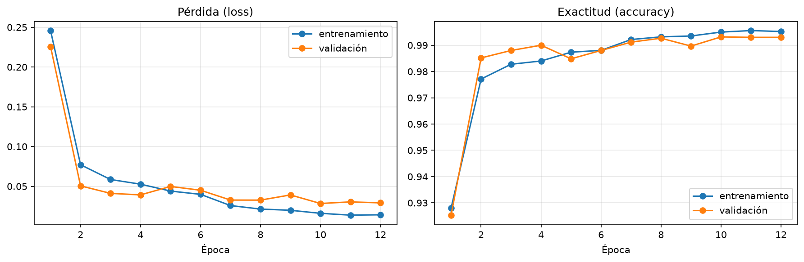
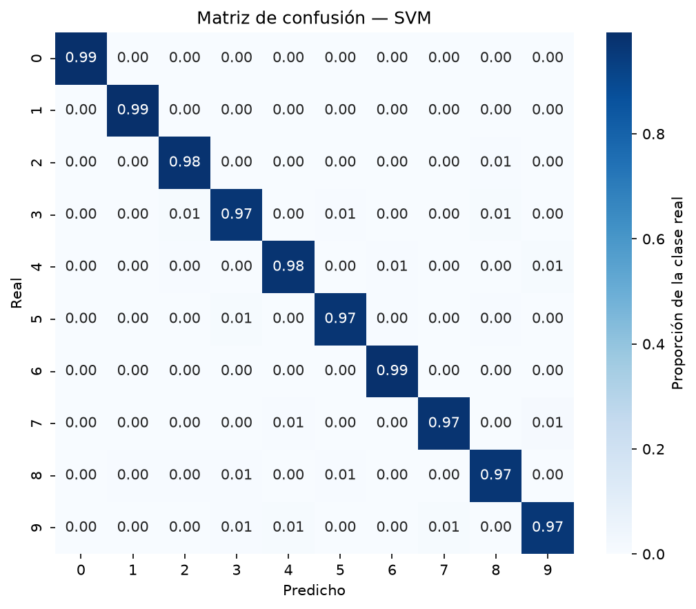

# Informe técnico — Reconocimiento de dígitos manuscritos para TecnoForms

**Dataset:** NIST Special Database 19 (`by_class`)
**Modelo principal:** CNN convolucional (422 026 parámetros)
**Accuracy en test:** 99.38 % sobre 80 595 imágenes nunca vistas en entrenamiento
**Fecha de la corrida:** 23 de octubre de 2026
**Reproducibilidad:** semilla 42 en todas las etapas

> Todas las cifras de este informe provienen de `reports/metrics/`. Ningún número fue
> estimado a mano. Los JSON y CSV citados son la fuente de verdad.

---

## 1. Resumen ejecutivo

Se construyó un pipeline completo de reconocimiento de dígitos manuscritos que va desde la
inspección del dataset crudo hasta la lectura de un formulario sintético, pasando por
selección, división, preprocesamiento, segmentación, entrenamiento de cuatro modelos,
evaluación y agrupamiento no supervisado.

Los resultados principales:

| Modelo | Accuracy en test | F1 macro | Error relativo |
|---|---:|---:|---:|
| **CNN** | **0.9938** | **0.9938** | **0.62 %** |
| SVM (RBF) | 0.9773 | 0.9771 | 2.27 % |
| KNN (k=3) | 0.9593 | 0.9590 | 4.07 % |
| Regresión logística | 0.9200 | 0.9188 | 8.00 % |

La CNN comete aproximadamente **un cuarto de los errores del SVM** (500 frente a 1 830) y
**trece veces menos que la regresión logística** (6 448), con un costo de entrenamiento de
437 s frente a 7 s del SVM. La lectura de formularios sintéticos alcanzó 85.83 % de dígitos correctos y 55 % de
campos exactos; el análisis muestra que **el cuello de botella en esa etapa no es el
clasificador sino la segmentación**.

---

## 2. Introducción y descripción del problema

TecnoForms digitaliza formularios físicos en educación y finanzas. El dato que más
trabajo manual consume es el **dígito manuscrito**: números de legajo, importes,
fechas y códigos se transcriben hoy a mano, con costo y errores humanos.

El objetivo del sistema es convertir una imagen de un formulario en una cadena de dígitos
sin intervención humana. El problema se descompone en dos subproblemas clásicos de visión
computacional:

1. **Segmentación:** aislar cada dígito del resto de la imagen (separarlo del fondo, de
   otros dígitos y del texto impreso).
2. **Clasificación:** asignar a cada recorte una de diez clases (0–9).

La clasificación de dígitos manuscritos aislados es un problema prácticamente resuelto
(>99 % con redes convolucionales sobre MNIST). La dificultad real de un producto como
TecnoForms no está en el clasificador aislado, sino en la **calidad del recorte** que se le
entrega. Este informe documenta ambos frentes por separado y muestra, con evidencia, que
esa afirmación se sostiene en los datos.

---

## 3. Objetivos

**Objetivo general:** construir y evaluar un pipeline reproducible de reconocimiento de
dígitos manuscritos sobre NIST SD19, con una CNN como modelo principal, modelos clásicos
de referencia y una demostración de lectura de formularios.

**Objetivos específicos:**

- Inspeccionar el dataset crudo y documentar qué contiene, incluidos los archivos `.mit`.
- Seleccionar solo imágenes de dígitos válidas, sin duplicados exactos.
- Dividir 80/20 de forma estratificada por dígito y auditable.
- Implementar preprocesamiento y segmentación reutilizables.
- Entrenar y comparar CNN, KNN, SVM y regresión logística bajo las mismas condiciones de
  evaluación.
- Explorar la estructura de los datos con K-Means.
- Medir el desempeño de punta a punta sobre formularios sintéticos.
- Documentar limitaciones y trabajo futuro con honestidad.

---

## 4. Dataset y hallazgos de la inspección

### 4.1 Composición

`data/puro/by_class` contiene **62 carpetas** nombradas con el código hexadecimal ASCII del
carácter:

- **10 carpetas de dígitos** (`30`–`39`, es decir `0`–`9`): **747 260 archivos PNG**.
- **52 carpetas de letras** (`41`–`5a`, `61`–`7a`, mayúsculas y minúsculas): se ignoran
  porque el alcance del proyecto son los dígitos.

Cada carpeta de dígito tiene 8 subcarpetas (`hsf_0`…`hsf_7`), donde `hsf` = *handprinted
sample forms*, más los archivos de índice `.mit`.

Balance entre clases (PNG por dígito):

| Dígito | PNG | Dígito | PNG |
|---|---:|---|---:|
| 0 | 75 166 | 5 | 67 673 |
| 1 | 82 753 | 6 | 74 016 |
| 2 | 74 256 | 7 | 77 689 |
| 3 | 76 405 | 8 | 73 463 |
| 4 | 72 586 | 9 | 73 253 |

Mínimo 67 673 (dígito 5), máximo 82 753 (dígito 1), **ratio máximo/mínimo = 1.22**. Es un
dataset razonablemente balanceado: no hace falta *oversampling* ni ponderación de clases,
y las métricas macro son interpretables sin corregir desbalance.

### 4.2 Los archivos `.mit`: qué contienen y si se usaron

Se revisaron los **70 archivos `.mit`** (~21.4 MB) en lugar de asumir su formato. Son
**texto plano**:

```text
2000
hsf_0_00000.png f0000_14/d0000_14/d0000_14_00000.png
hsf_0_00001.png f0000_14/d0000_14/d0000_14_00001.png
...
```

- **Primera línea:** cantidad de entradas del índice.
- **Cada línea siguiente:** `imagen_destino ruta_origen`, es decir el nombre del PNG ya
  extraído y su ruta dentro del archivo original de formularios de NIST.

**Uso en el proyecto:** se aprovecharon, pero **no como imagen de entrada** (no contienen
píxeles). Se usaron para dos cosas:

1. **Trazabilidad del escritor:** el prefijo `fNNNN` de la ruta de origen identifica al
   formulario/escritor. Se extrajo y se guardó en la columna `escritor` de
   `data/manifest.csv`, habilitando a futuro una división por grupo (`GroupShuffleSplit`).
2. **Detección de duplicados entre particiones:** explicar por qué `train_*` repite
   imágenes de `hsf_*` (ver 5.2).

Sin abrir los `.mit` no habría sido posible detectar la fuga por escritor ni justificar el
descarte masivo de duplicados con evidencia.

### 4.3 Naturaleza de las imágenes

Los PNG son **128×128, RGB, con fondo claro y trazo oscuro**. Esto es relevante: el
preprocesamiento debe invertir la imagen para que el trazo quede claro sobre fondo oscuro,
que es la convención con la que las CNN de dígitos funcionan mejor. Se verificó también que
las imágenes no vienen centradas ni normalizadas: el recorte al *bounding box* del trazo es
obligatorio.

---

## 5. Criterios de selección y descartes

### 5.1 Resultado

De los **747 260 PNG** de las carpetas de dígitos:

| Criterio | Imágenes | % |
|---|---:|---:|
| Conservadas (válidas y únicas) | **402 951** | 53.93 % |
| Descartadas por duplicado exacto (hash) | 344 309 | 46.07 % |
| Descartadas por ilegibles o sin trazo | 0 | 0.00 % |

También se registraron **3 579 escritores** distintos en el manifiesto.

Cada fila de `data/manifest.csv` guarda `ruta_original, digito, particion, escritor, hash,
valida, motivo_descarte`. Esto hace la selección **auditable**: cualquier imagen puede
rastrearse hasta su origen y su motivo de descarte.

### 5.2 Por qué se descartaron 344 309 imágenes (y por qué es correcto)

La inspección de particiones reveló el hallazgo más importante de esta etapa:

- `hsf_0`…`hsf_7` contienen **402 953** archivos, de los cuales **402 951** son únicos
  (2 colisiones internas).
- `train_30`…`train_39` contienen **344 307** archivos y **todos** son duplicados exactos
  de imágenes ya presentes en `hsf_*`.

Es decir: `train_*` no aporta ni una imagen nueva. Conservarlas habría producido **fuga de
datos directa**: la misma imagen podría caer en `fit` y en `test`, y la accuracy reportada
sería ficción. El descarte por hash **antes** de dividir es, por lo tanto, una decisión de
corrección metodológica, no una pérdida de información.

Se conservó siempre la copia con prefijo `hsf_` porque es la que tiene trazabilidad de
escritor en los `.mit`.

### 5.3 Otras validaciones

- Se descartaron imágenes vacías o sin trazo detectable (Otsu sobre el canal gris).
- Se verificó legibilidad de cada PNG antes de copiarlo a las particiones.
- `data/puro/` se trató como **solo lectura** en todo momento: ninguna etapa escribe,
  mueve ni borra archivos ahí.

---

## 6. División 80/20

División **estratificada por dígito**, semilla 42, sin solapamiento entre `fit` y `test`.

| Dígito | Total | `fit` (80 %) | `test` (20 %) |
|---|---:|---:|---:|
| 0 | 40 362 | 32 289 | 8 073 |
| 1 | 44 703 | 35 762 | 8 941 |
| 2 | 40 072 | 32 057 | 8 015 |
| 3 | 41 112 | 32 889 | 8 223 |
| 4 | 39 154 | 31 323 | 7 831 |
| 5 | 36 606 | 29 284 | 7 322 |
| 6 | 39 937 | 31 949 | 7 988 |
| 7 | 41 893 | 33 514 | 8 379 |
| 8 | 39 579 | 31 663 | 7 916 |
| 9 | 39 533 | 31 626 | 7 907 |
| **Total** | **402 951** | **322 356** | **80 595** |

Verificaciones automáticas (`reports/metrics/division.json`):

- Proporción global de test: **0.2000**.
- Proporción de test por dígito: **0.2000** en las diez clases.
- `disjuntos: true` (ningún hash aparece en ambas particiones).

La etapa es **idempotente**: reconstruye `data/fit` y `data/test` desde cero en cada
ejecución, de modo que el resultado no depende de corridas anteriores.

---

## 7. Tecnologías y librerías

| Componente | Versión | Rol |
|---|---|---|
| Python | 3.12.15 (standalone) | Intérprete |
| TensorFlow / Keras (CPU) | 2.21.0 | CNN |
| scikit-learn | 1.9.1 | KNN, SVM, regresión logística, K-Means, métricas, `GridSearchCV` |
| OpenCV (headless) | 5.0.0.93 | Lectura, umbralizado, morfología, componentes conectados |
| NumPy | 2.2.6 | Arrays y caché `.npz` |
| pandas | 3.1.0 | Manifiesto y tablas de resultados |
| Matplotlib / Seaborn | 3.11.2 / 0.13.2 | Figuras |
| pytest | 9.1.1 | Pruebas automáticas |
| joblib | 1.6.0 | Serialización de modelos clásicos |

**Hardware:** CPU de 12 núcleos, 15 GB de RAM, sin GPU. TensorFlow se instaló como
`tensorflow-cpu`. El sistema traía Python 3.14, para el cual TensorFlow no publica
*wheels*; se instaló un CPython 3.12.15 standalone en `~/.local/opt/py312` y se creó el
`.venv` del proyecto.

---

## 8. Estructura del proyecto y ejecución

```text
.
├── main.py                     # Orquestador de etapas, sin lógica de negocio
├── requirements.txt
├── src/
│   ├── config.py               # Rutas, semilla, tamaños, presupuestos
│   ├── utils.py                # Logging, semillas, JSON, hashes
│   ├── datos/                  # inspeccion, seleccion, division, cargador
│   ├── imagenes/               # preprocesamiento, segmentacion
│   ├── modelos/                # clasicos, clustering, cnn
│   ├── entrenamiento.py        # CV, hiperparámetros, entrenamiento CNN
│   ├── evaluacion/             # metricas, visualizacion
│   └── inferencia.py           # Formularios sintéticos de punta a punta
├── tests/                      # 4 archivos de pruebas
├── data/                       # puro (solo lectura), fit, test, processed
├── models/                     # .keras y .joblib
└── reports/                    # figures/, metrics/, arquitectura_cnn.txt, informe.md
```

Etapas independientes; cada una lee de disco y escribe sus artefactos, así que puede
ejecutarse sola:

```bash
python main.py                                  # pipeline completo
python main.py --etapas inspeccion seleccion division
python main.py --etapas cnn --muestras-cnn 30000 --epocas 8
python main.py --rapido                         # humo: 2k muestras, 1 época
pytest                                          # 11 pruebas, ~2 s
```

---

## 9. Preprocesamiento y segmentación

### 9.1 Preprocesamiento (imagen individual → tensor 28×28)

Cada imagen pasa por:

1. **Escala de grises** (BGR/BGRA → un canal).
2. **Inversión condicional** si el fondo es claro (mediana > 127), para dejar el trazo
   claro sobre fondo oscuro.
3. **Umbralizado de Otsu** solo para localizar el trazo (*bounding box*).
4. **Recorte** al rectángulo mínimo que contiene el trazo.
5. **Escalado** conservando la proporción, con el lado mayor fijado en **20 px**
   (`INTER_AREA` al reducir, `INTER_LINEAR` al ampliar).
6. **Centrado** en un lienzo negro de **28×28**, lo que deja 4 px de margen.
7. **Normalización** a `float32` en `[0, 1]`.

Si una imagen no tiene trazo, la función lanza un error explícito en lugar de devolver un
tensor vacío silencioso.

El resultado se cachea en `data/processed/fit_28x28.npz` y `test_28x28.npz` (322 356 y
80 595 imágenes). La caché valida versión y tamaño; si cambia la selección o el
preprocesamiento, debe borrarse.

### 9.2 Segmentación de formularios

Componentes conectados sobre la imagen binarizada:

- Se descartan componentes con área menor a 30 px (ruido).
- Se **recomponen fragmentos** de un mismo dígito partido en dos trazos mediante unión de
  cajas verticalmente próximas y alineadas (`unir_fragmentos`).
- Se **ordenan** las cajas en orden de lectura: izquierda→derecha, arriba→abajo, agrupando
  por líneas con tolerancia vertical de 20 px.

**Limitación estructural:** dos dígitos que se tocan forman un único componente y no se
separan. Un dígito partido en fragmentos que no cumplen las condiciones de unión produce
dos recortes. Ambas situaciones aparecen en la demo de formularios (sección 15).

---

## 10. Selección de algoritmos y justificación

**CNN (modelo principal).** Las capas convolucionales explotan la estructura espacial del
trazo: comparten pesos entre posiciones, detectan trazos locales y componen jerarquías
(bordes → curvas → bucles). Un dígito manuscrito es, esencialmente, una forma
bidimensional; aplanarlo a 784 píxeles destruye la vecindad espacial. Además, la CNN es
robusta a traslaciones y a variaciones de grosor, que son exactamente las fuentes de
variabilidad entre escritores.

**KNN (referencia no paramétrica).** No aprende nada: memoriza. Sirve como línea base
honesta de "cuán lejos llega la similitud directa entre píxeles". Se le aplica
`PCA(n_components=50)` antes de comparar: en 784 dimensiones las distancias se vuelven poco
discriminativas (*maldición de la dimensionalidad*) y la reducción de dimensionalidad es lo
que lo hace viable. Aun así, cada predicción cuesta comparar contra todo el conjunto de
entrenamiento.

**SVM con kernel RBF (referencia fuerte).** Encuentra fronteras de decisión no lineales
maximizando el margen. Comparte el `PCA(50)` con KNN para que ambos vean la misma
representación comprimida. Sobre características de píxeles suele ser el mejor de los
clásicos, y aquí lo confirma. Su límite práctico es el costo de entrenamiento y de
predicción, que crece con la cantidad de vectores de soporte.

**Regresión logística (referencia lineal interpretable).** Modelo lineal multinomial con
softmax. Es el más rápido y el más fácil de explicar, pero su frontera lineal no puede
capturar la complejidad de la escritura manuscrita. Se incluye precisamente para medir
cuánto aporta la no linealidad.

**K-Means (exploración no supervisada).** No clasifica: agrupa. Se usa para responder una
pregunta distinta: ¿la estructura de los píxeles se organiza naturalmente en diez grupos?
Si sí, un modelo supervisado debería tenerlo fácil; si no, las confusiones entre clases son
esperables.

**Criterio de comparación.** Los cuatro modelos supervisados se evalúan sobre **el mismo
conjunto de test completo** (80 595 imágenes), con las mismas métricas. KNN, SVM y
regresión logística se entrenan sobre una submuestra estratificada de 10 000 imágenes de
`fit` por costo computacional; la CNN sobre 60 000. Ambas submuestras están declaradas en
`src/config.py`, en el README y en este informe. Esta asimetría **favorece a los clásicos
en tiempo y a la CNN en datos**; ninguna de las dos se oculta.

---

## 11. Arquitectura de la red neuronal

Documentación completa en `reports/arquitectura_cnn.txt` (salida literal de
`model.summary()`).

| # | Capa | Salida | Parámetros |
|---|---|---|---:|
| 1 | `Conv2D(32, 3×3, ReLU)` | 28×28×32 | 320 |
| 2 | `BatchNormalization` | 28×28×32 | 128 |
| 3 | `MaxPooling2D(2×2)` | 14×14×32 | 0 |
| 4 | `Conv2D(64, 3×3, ReLU)` | 14×14×64 | 18 496 |
| 5 | `BatchNormalization` | 14×14×64 | 256 |
| 6 | `MaxPooling2D(2×2)` | 7×7×64 | 0 |
| 7 | `Flatten` | 3136 | 0 |
| 8 | `Dropout(0.4)` | 3136 | 0 |
| 9 | `Dense(128, ReLU)` | 128 | 401 536 |
| 10 | `Dropout(0.3)` | 128 | 0 |
| 11 | `Dense(10, Softmax)` | 10 | 1 290 |

- **Parámetros del modelo:** 421 834 entrenables + 192 de *batch norm* = **422 026**
  (1.61 MB). El resumen de Keras reporta además 843 670 parámetros del optimizador Adam,
  que no forman parte de la red y no se usan en inferencia.
- **Activaciones:** ReLU en las capas ocultas, softmax en la salida.
- **Optimización:** Adam con `learning_rate = 1e-3`, `sparse_categorical_crossentropy`,
  `batch_size = 128`.
- **Regularización:** `BatchNormalization` tras cada convolución (estabiliza y acelera),
  dos capas de `Dropout` (0.4 convolucional, 0.3 denso).
- **Callbacks:** `EarlyStopping` sobre `val_accuracy` con restauración de los mejores pesos
  y `ReduceLROnPlateau`.
- **Entrada:** 28×28×1, un canal.

La red es deliberadamente compacta: 422k parámetros alcanzan para 10 clases con 54 000
imágenes de entrenamiento. Una arquitectura más grande no se justifica con este volumen y
solo aumentaría el tiempo de entrenamiento en CPU.

---

## 12. Entrenamiento, validación cruzada e hiperparámetros

### 12.1 Modelos clásicos

`GridSearchCV` con **validación cruzada estratificada de 5 pliegues** sobre una submuestra
estratificada de 10 000 imágenes de `fit`. KNN y SVM son un `Pipeline` con
**`PCA(n_components=50)`** antes del clasificador; la regresión logística trabaja
directamente sobre los 784 píxeles.

| Modelo | Rejilla | Mejor configuración | Accuracy CV | F1 macro CV | Tiempo |
|---|---|---|---:|---:|---:|
| KNN | `n_neighbors ∈ {3, 5, 7}` | `k = 3` | 0.9560 | 0.9556 | 3.2 s |
| SVM (RBF) | `C ∈ {1, 5, 10}`, `gamma ∈ {scale, 0.01}` | `C = 5`, `gamma = scale` | 0.9746 | 0.9743 | 6.9 s |
| Regresión logística | `C ∈ {1.0, 10.0}` | `C = 1.0` | 0.9141 | 0.9128 | 22.2 s |

Fuente: `reports/metrics/hiperparametros.csv`.

Observaciones:

- **KNN prefiere k = 3**, el valor más bajo de la rejilla: con k = 5 y k = 7 suaviza
  demasiado y confunde clases de trazo parecido.
- **SVM prefiere `C = 5` con `gamma = scale`**: un margen moderadamente estricto y un
  kernel ajustado a la dimensionalidad efectiva de los datos.
- **La regresión logística tarda más que el SVM** (22.2 s vs 6.9 s) porque su solver
  iterativo tiene que converger sobre 784 características y 10 clases; el SVM con kernel
  RBF resuelve un problema más pequeño. Es un buen recordatorio de que "modelo simple" no
  siempre significa "más rápido".

### 12.2 CNN

- **Submuestra:** 60 000 imágenes de `fit`, divididas en 54 000 para entrenar y 6 000 para
  validar (`VAL_SPLIT = 0.10`).
- **Dos configuraciones comparadas** (misma arquitectura, distinta regularización):

| Configuración | lr | Dropout (conv/denso) | Épocas ejecutadas | Mejor `val_accuracy` | Mejor `val_loss` | Tiempo |
|---|---|---:|---:|---:|---:|---:|
| **base** | 1e-3 | 0.4 / 0.3 | 11 de 12 | **0.9932** | 0.0268 | 436.9 s |
| regularizada | 5e-4 | 0.5 / 0.4 | 8 de 8 | 0.9913 | 0.0259 | 319.2 s |

Se eligió **`base`** por mayor `val_accuracy` (criterio de selección del modelo), y se
guardó como `models/cnn.keras`. La configuración regularizada logró un `val_loss`
marginalmente menor pero peor accuracy: con más dropout y menos *learning rate* el modelo
aprende más despacio y no llega al mismo punto en 8 épocas.

**Curva de aprendizaje (configuración base):** 89.6 % en la época 1 → 98.6 % en la 2 →
99.0 % en la 3, y luego una meseta de 99.2–99.3 % hasta la época 11. La meseta temprana y
la estabilidad de `val_loss` (~0.027–0.031) indican que el modelo está limitado por el
volumen de datos y el techo del dataset (ruido de etiquetado, dígitos ambiguos), no por
capacidad.



**Costo:** 437 s por configuración en CPU (≈ 40 s por época con 54 000 imágenes, unas
1 350 imágenes/s). El pipeline completo, incluyendo caché de 402 951 imágenes, corre en
menos de una hora.

---

## 13. Resultados

### 13.1 Comparación de modelos (80 595 imágenes de test)

Fuente: `reports/metrics/comparacion_modelos.csv`.

| Modelo | Accuracy | Precision macro | Recall macro | F1 macro | Accuracy validación | Entrenamiento | Inferencia |
|---|---:|---:|---:|---:|---:|---:|---:|
| **CNN** | **0.9938** | **0.9938** | **0.9938** | **0.9938** | 0.9932 | 436.9 s | 0.078 ms/img |
| SVM | 0.9773 | 0.9771 | 0.9770 | 0.9771 | 0.9746 | 6.9 s | 0.141 ms/img |
| KNN | 0.9593 | 0.9598 | 0.9587 | 0.9590 | 0.9560 | 3.2 s | 0.012 ms/img |
| Regresión logística | 0.9200 | 0.9189 | 0.9187 | 0.9188 | 0.9141 | 22.2 s | 0.001 ms/img |

Lectura:

- **CNN: 99.38 %**, es decir unos **500 errores en 80 595 imágenes**. La brecha entre
  accuracy de validación (99.32 %) y de test (99.38 %) es de 0.06 puntos: no hay
  sobreajuste apreciable y el conjunto de test confirma la validación.
- **SVM: 97.73 %**. Notablemente fuerte para un modelo clásico: 1 830 errores. Es la
  referencia seria, no un *baseline* de trámite.
- **KNN: 95.93 %**. 3 280 errores. Sorprende por debajo de su accuracy de validación
  (95.60 % → 95.93 %, sube levemente), lo que indica que la submuestra de CV era
  representativa.
- **Regresión logística: 92.00 %**. 6 448 errores. La brecha de casi 7.4 puntos con la CNN
  es la medida directa de cuánto aporta modelar no linealidad y estructura espacial.
- **Tiempos de inferencia:** la regresión logística es 78 veces más rápida que la CNN por
  imagen (0.001 ms vs 0.078 ms). Para 80 595 imágenes: 0.08 s vs 6.3 s. En un formulario
  real de 12 dígitos la diferencia es irrelevante; en un lote de millones de documentos sí
  importa, y es el argumento honesto a favor de un modelo lineal si la accuracy alcanzara.

Nótese que **precision, recall y F1 macro coinciden casi exactamente con la accuracy** en
los cuatro modelos. Eso confirma que no hay clases favorecidas: el dataset balanceado y la
estratificación hacen que la accuracy no esconda un mal desempeño en alguna clase.


### 13.2 CNN por clase

| Dígito | Precision | Recall | F1 | Soporte |
|---|---:|---:|---:|---:|
| 0 | 0.9944 | 0.9965 | 0.9955 | 8 073 |
| 1 | 0.9934 | 0.9982 | 0.9958 | 8 941 |
| 2 | 0.9929 | 0.9940 | 0.9935 | 8 015 |
| 3 | 0.9934 | 0.9943 | 0.9939 | 8 223 |
| 4 | 0.9919 | 0.9963 | 0.9941 | 7 831 |
| 5 | 0.9936 | 0.9937 | 0.9936 | 7 322 |
| 6 | 0.9954 | 0.9955 | 0.9954 | 7 988 |
| 7 | 0.9923 | 0.9936 | 0.9929 | 8 379 |
| 8 | 0.9969 | 0.9894 | 0.9932 | 7 916 |
| 9 | 0.9943 | 0.9862 | 0.9902 | 7 907 |

- **Mejor F1:** dígito 1 (0.9958). Es el dígito con menos variantes morfológicas.
- **Peor F1:** dígito 9 (0.9902), seguido de 7 (0.9929) y 8 (0.9932).
- El **9 tiene el recall más bajo (0.9862) con precision alta (0.9943)**: cuando el modelo
  se equivoca con un 9, casi siempre lo asigna a otra clase, pero rara vez inventa un 9
  donde no lo hay. Es el patrón de una clase con alta variabilidad interna.
- El **8 tiene la precision más alta (0.9969) y el recall más bajo junto al 9 (0.9894)**:
  es una clase "atractora", otros dígitos caen en ella, pero sus propios ejemplares a veces
  se van a 3 o 5.

### 13.3 Matrices de confusión

Disponibles para los cuatro modelos:




Las de KNN y regresión logística están en `figures/matriz_confusion_knn.png` y
`figures/matriz_confusion_regresion_logistica.png`.

La matriz de la CNN es casi diagonal: todas las celdas fuera de la diagonal están por
debajo de 0.01 de la clase real. Las de los modelos clásicos muestran el mismo patrón
cualitativo, pero con más masa fuera de la diagonal en las mismas parejas de dígitos, lo
que confirma que **los errores son estructurales del problema, no del modelo**.

### 13.4 Pares más confundidos

**CNN** (`metricas_cnn.json`):

| Real | Predicho | Casos | % de la clase |
|---:|---:|---:|---:|
| 9 | 7 | 31 | 0.39 |
| 9 | 4 | 30 | 0.38 |
| 5 | 3 | 19 | 0.26 |
| 3 | 2 | 17 | 0.21 |
| 7 | 1 | 16 | 0.19 |

**SVM:**

| Real | Predicho | Casos | % de la clase |
|---:|---:|---:|---:|
| 7 | 9 | 108 | 1.29 |
| 5 | 3 | 76 | 1.04 |
| 9 | 4 | 75 | 0.95 |
| 9 | 7 | 73 | 0.92 |
| 3 | 8 | 71 | 0.86 |

**KNN:**

| Real | Predicho | Casos | % de la clase |
|---:|---:|---:|---:|
| 8 | 3 | 245 | 3.09 |
| 9 | 4 | 168 | 2.12 |
| 4 | 9 | 161 | 2.06 |
| 9 | 7 | 158 | 2.00 |
| 8 | 5 | 152 | 1.92 |

**Regresión logística:**

| Real | Predicho | Casos | % de la clase |
|---:|---:|---:|---:|
| 8 | 5 | 326 | 4.12 |
| 5 | 3 | 252 | 3.44 |
| 4 | 9 | 245 | 3.13 |
| 7 | 9 | 240 | 2.86 |
| 9 | 7 | 221 | 2.79 |

El patrón es **coherente entre modelos**: los mismos pares aparecen una y otra vez
(9↔7, 9↔4, 5↔3, 8↔3/5, 3↔2). Eso es evidencia de que la confusión proviene de la
escritura, no del clasificador. La CNN simplemente reduce la magnitud del fenómeno: el par
9→7 pasa de 158 casos (KNN) a 31 (CNN), un factor de 5.

---

## 14. Resultados de K-Means

Configuración: **k = 10** (uno por dígito), 20 000 imágenes de `fit`, inicialización
`k-means++`, semilla 42. Fuente: `reports/metrics/kmeans.json`.

| Métrica | Valor | Interpretación |
|---|---:|---|
| ARI (Adjusted Rand Index) | **0.3609** | Concordancia con las etiquetas reales, corregida por azar. Moderada. |
| NMI (Normalized Mutual Information) | **0.4730** | Comparte ~47 % de información con las etiquetas. Moderada. |
| Pureza global | **0.5685** | 56.9 % de las imágenes caen en un clúster dominado por su propio dígito. |
| Inercia | 815 363.38 | Suma de distancias al centroide; sin referencia externa no es interpretable sola. |

Pureza por clúster:

| Clúster | Tamaño | Dígito dominante | Pureza |
|---:|---:|---:|---:|
| 0 | 1 451 | 2 | **0.8822** |
| 3 | 1 567 | 0 | **0.8628** |
| 4 | 2 090 | 6 | 0.7435 |
| 9 | 1 820 | 1 | 0.7385 |
| 8 | 2 562 | 3 | 0.6448 |
| 1 | 1 979 | 8 | 0.6129 |
| 6 | 1 667 | 5 | 0.4073 |
| 7 | 2 188 | 1 | 0.3565 |
| 2 | 2 522 | 9 | 0.3394 |
| 5 | 2 154 | 4 | 0.3064 |

Interpretación:

- Los clústeres **0 y 3 son casi puros (88 % y 86 %)** y corresponden a dígitos con forma
  muy estable: el 2 y el 0.
- Los clústeres **5 y 2 son los más impuros (~31 % y 34 %)** y agrupan 4 y 9. Son dígitos
  con gran variabilidad de trazo (el 4 puede escribirse abierto o cerrado; el 9 con o sin
  lazo inferior).
- **Dos clústeres (7 y 9) tienen al 1 como dominante** con purezas de 35.7 % y 73.9 %. El
  algoritmo partió el dígito 1 en dos modos morfológicos: el 1 "simple" (una línea) y el 1
  con base o serif. Esto es un hallazgo interesante: demuestra que la variabilidad
  intra-clase del 1 es comparable a la distancia entre clases distintas.
- El hecho de que **k = 10 no produzca diez clústeres puros** explica por qué los modelos
  supervisados confunden ciertos pares: la estructura de píxeles no separa limpiamente las
  diez clases. El valor moderado de ARI/NMI no indica un mal algoritmo, sino que **el
  problema no es linealmente separable en el espacio de píxeles crudos**.


---

## 15. Lectura de formularios sintéticos

Se generaron **10 formularios sintéticos** con 2 campos de 6 dígitos cada uno (120 dígitos
en total), compuestos con imágenes reales de `data/test` colocadas en posiciones
controladas. La CNN lee cada formulario de punta a punta: segmentación → recorte →
preprocesamiento → predicción → armado de la cadena. Fuente:
`reports/metrics/inferencia.json`.

| Métrica | Valor |
|---|---:|
| Formularios | 10 |
| Campos | 20 |
| Dígitos | 120 |
| **Acierto por dígito** | **85.83 %** (103/120) |
| **Campos exactos** | **55.00 %** (11/20) |

Detalle por formulario:

| # | Esperado | Obtenido | Campos exactos |
|---:|---|---|---:|
| 0 | 031903 / 692531 | 031903 / 692531 | 2/2 |
| 1 | 477896 / 117991 | 477896 / **11799** | 1/2 |
| 2 | 824124 / 559844 | 824124 / 559844 | 2/2 |
| 3 | 610019 / 210251 | 610019 / **2025** | 1/2 |
| 4 | 680028 / 777371 | **681028** / 777371 | 1/2 |
| 5 | 198900 / 093358 | **98900** / **093354** | 0/2 |
| 6 | 582782 / 122514 | 582782 / **120514** | 1/2 |
| 7 | 550403 / 015496 | 550403 / **015491** | 1/2 |
| 8 | 478855 / 116514 | **478155** / 116514 | 1/2 |
| 9 | 836896 / 105507 | 836896 / **1055477** | 1/2 |

**El dato clave está en los largos.** En **16 de 20 campos** la cantidad de dígitos
detectados coincide con la esperada. Dentro de esos 16 campos (96 dígitos), el acierto es
de **94.79 % (91/96)**, consistente con el 99.38 % del clasificador menos las diferencias
entre el recorte sintético y el preprocesamiento de test.

Los **4 campos restantes fallaron por segmentación**, no por clasificación:

- Formulario 1, campo 2: `117991` → `11799` (un dígito perdido, probablemente unido al
  vecino).
- Formulario 3, campo 2: `210251` → `2025` (dos dígitos perdidos).
- Formulario 5, campo 1: `198900` → `98900` (el `1` inicial se perdió).
- Formulario 9, campo 2: `105507` → `1055477` (un dígito partido en dos recortes).


Las figuras `figures/formulario_01.png` y `figures/formulario_02.png` muestran los otros dos
formularios con sus cajas detectadas y la comparación esperado/obtenido.

**Conclusión de esta sección:** el clasificador no es el cuello de botella del producto. El
99.38 % de la CNN se degrada a 85.83 % de punta a punta por la segmentación. Cualquier
mejora de producto debe invertir primero en separar dígitos pegados y en robustecer la
detección, no en una red más grande.

---

## 16. Interpretación de los resultados

### 16.1 ¿Por qué gana la CNN?

Tres razones concretas, verificables en los datos:

1. **Estructura espacial.** La CNN ve la imagen como una grilla 28×28; los modelos clásicos
   la ven como un vector de píxeles (784, o 50 componentes tras el PCA), donde el píxel
   (0,0) está tan lejos del (0,1) como del (27,27). Un trazo desplazado dos píxeles es, para
   un modelo lineal, un ejemplo completamente distinto; para una convolución, es el mismo
   trazo en otra posición. El `PCA(50)` de KNN y SVM es una proyección lineal: comprime la
   información, pero no compone rasgos ni recupera vecindad espacial.
2. **Invarianza a traslación y tolerancia a deformación.** Las convoluciones comparten
   pesos, de modo que un rasgo aprendido en una esquina se reconoce en el centro. Eso es
   exactamente la variabilidad que introduce cada escritor.
3. **Jerarquía.** La primera capa detecta bordes y orientaciones; la segunda combina esos
   bordes en curvas y cruces. Los modelos clásicos no tienen mecanismo para componer
   features de nivel superior.

### 16.2 ¿Por qué los errores se concentran en 9, 7, 4, 8, 5 y 3?

Los pares confundidos no son aleatorios y coinciden entre los cuatro modelos, incluida la
estructura no supervisada de K-Means:

- **9 ↔ 7:** un 9 escrito con el lazo superior abierto y el trazo descendente recto es
  indistinguible de un 7 con trazo curvo. Depende del escritor, no del clasificador.
- **9 ↔ 4:** el 4 "abierto" (sin cerrar el triángulo) puede parecerse a un 9 si el trazo
  vertical se inclina y el horizontal se acorta.
- **5 ↔ 3:** si el trazo superior del 5 es corto y el inferior redondeado, la silueta es
  casi la de un 3. Es el par con más errores en tres de los cuatro modelos.
- **8 ↔ 3 / 8 ↔ 5:** un 8 dibujado con el lazo inferior abierto pierde su rasgo
  definitorio y se acerca a 3 o 5.
- **3 ↔ 2:** el trazo inferior del 3 y el del 2 comparten la misma curva base.

Nótese que el **dígito 1 es el mejor clasificado (F1 0.9958)** y a la vez su variabilidad
interna es tan alta que K-Means lo parte en dos clústeres. Ambas cosas son consistentes:
el 1 tiene dos modos bien definidos (con y sin base), y un modelo supervisado con 8 941
ejemplos de test aprende ambos; un algoritmo no supervisado, en cambio, los ve como dos
grupos.

### 16.3 ¿Es realista el 99.38 %?

Sí para este dataset, con una advertencia metodológica importante: **la división es
aleatoria por imagen**, como pide el enunciado. Eso significa que imágenes del mismo
escritor pueden aparecer en `fit` y en `test`. NIST SD19 tiene 3 579 escritores y cada uno
aporta decenas de ejemplares por dígito; el modelo puede aprender el estilo individual y
"reconocerlo" en test. En un despliegue real con escritores nuevos, la accuracy sería
**algo menor**. El manifiesto ya guarda el ID de escritor para poder medirlo con
`GroupShuffleSplit` (ver sección 18).

Aun así, hay evidencia de que la cifra no es puro artefacto: la accuracy de validación
(99.32 %) y la de test (99.38 %) coinciden, y las confusiones que quedan son
morfológicamente explicables (9/7, 5/3). Un modelo que solo memorizara escritores tendría
confusiones más erráticas.

---

## 17. Limitaciones

1. **Fuga por escritor (la más importante).** La división estratificada por dígito,
   requerida por el enunciado, no agrupa por escritor. Un mismo escritor puede aportar
   imágenes a `fit` y a `test`, lo que infla la accuracy frente a escritores nuevos. El
   manifiesto ya contiene la columna `escritor` (`fNNNN`), de modo que la corrección es
   directa: `GroupShuffleSplit` por escritor. No se aplicó porque cambiaría la división
   pedida y las cifras dejarían de ser comparables con el requisito 3.
2. **Dígitos que se tocan.** Los componentes conectados fusionan dos dígitos en contacto
   en una sola caja, y el sistema no los separa. En la demo de formularios esto produjo
   4 de 20 campos fallidos. Es la causa dominante del error de punta a punta.
3. **Dígitos partidos.** Un trazo cortado en fragmentos que no cumplen las condiciones de
   unión produce dos recortes (formulario 9, campo 2: `105507` → `1055477`). La heurística
   `unir_fragmentos` mitiga pero no elimina el problema.
4. **Formularios reales no probados.** La demo usa formularios **sintéticos** armados con
   imágenes de `data/test` sobre fondo limpio. No se probó con escaneos reales, que
   agregan ruido, sombras, líneas de formulario impresas, sellos y escritura cursiva. Los
   resultados de la sección 15 validan el diseño del pipeline, no su robustez en producción.
5. **Submuestras declaradas.** KNN, SVM y regresión logística se entrenan con 10 000
   imágenes y la CNN con 60 000, de las 322 356 disponibles en `fit`. Los tres clásicos
   están en desventaja por datos; la CNN, por tiempo de cómputo. La comparación es honesta
   entre ellos en el eje de test, pero no es una comparación de "mejor caso" para los
   clásicos.
6. **Solo CPU.** Sin GPU, la búsqueda de hiperparámetros de la CNN se limitó a dos
   configuraciones. Una búsqueda más amplia (profundidad, filtros, *data augmentation*)
   podría subir décimas, aunque el techo del dataset probablemente esté cerca.
7. **Sin validación con escritores nuevos ni con dígitos fuera de distribución** (por
   ejemplo, escritura cursiva o dígitos sobre líneas impresas).

---

## 18. Conclusiones y trabajo futuro

### Conclusiones

1. **El pipeline funciona y es reproducible.** Las nueve etapas corren de forma
   independiente, con semilla fija, desde la inspección del dataset crudo hasta la lectura
   de un formulario, en menos de una hora en CPU.
2. **La CNN es el mejor modelo, y por un margen claro.** 99.38 % contra 97.73 % del SVM,
   95.93 % del KNN y 92.00 % de la regresión logística, sobre 80 595 imágenes de test
   nunca vistas.
3. **La brecha entre modelos mide el valor de la estructura espacial.** Los 7.4 puntos que
   separan a la CNN de la regresión logística son, en la práctica, el precio de aplanar la
   imagen a 784 píxeles.
4. **Los modelos clásicos siguen siendo útiles.** El SVM alcanza 97.73 % entrenando en 7
   segundos: si el requisito fuera velocidad de desarrollo y no precisión máxima, es una
   opción perfectamente defendible.
5. **Los errores son del problema, no del modelo.** Los mismos pares (9/7, 5/3, 9/4, 8/3)
   se confunden en los cuatro modelos y reaparecen en la estructura de K-Means. Ningún
   ajuste de hiperparámetros los va a eliminar.
6. **El cuello de botella del producto es la segmentación.** El clasificador acierta
   99.38 % en dígitos ya recortados, pero el pipeline completo baja a 85.83 % por dígito y
   55 % por campo exacto: 4 de los 9 campos fallidos se explican por segmentación.
7. **Los `.mit` fueron útiles y se aprovecharon.** No como imagen, sino como fuente de
   trazabilidad de escritor y como prueba de que `train_*` duplica `hsf_*`.
8. **El descarte de 344 309 imágenes fue una corrección, no una pérdida.** Sin él habría
   fuga directa entre `fit` y `test`.

### Trabajo futuro, en orden de impacto esperado

1. **Segmentación robusta de dígitos en contacto.** Es la mejora de mayor retorno:
   proyección vertical con valles, *watershed* sobre la distancia, o un detector de objetos
   (YOLO/SSD) entrenado para devolver cajas de dígitos. Pasar de 85.83 % a ~95 % de punta a
   punta depende de esto, no del clasificador.
2. **División por escritor con `GroupShuffleSplit`.** Medir la accuracy real frente a
   escritores nuevos. La columna `escritor` ya está en el manifiesto; es un cambio de una
   línea más la re-ejecución del pipeline. Es la prueba de honestidad del 99.38 %.
3. **Entrenar los clásicos con más datos.** Verificar si la brecha con la CNN se cierra
   parcialmente al darles las 322 356 imágenes de `fit` (o al menos 100 000).
4. **Data augmentation en la CNN.** Rotaciones leves, desplazamientos, cambios de grosor y
   de contraste. Con 54 000 imágenes reales y una red de 422k parámetros, es la vía más
   barata para robustez ante escritores nuevos.
5. **Prueba con formularios reales escaneados.** Ruido, sombras, líneas impresas y sellos
   son el escenario de producción. Sin esta prueba, los resultados de la sección 15 son un
   *smoke test*, no una validación.
6. **Rechazo de casos dudosos.** Usar la probabilidad softmax para marcar dígitos con baja
   confianza y derivarlos a revisión humana. En un producto documental, un 90 % automático
   con cola de revisión suele ser más valioso que un 99 % que falla en silencio.
7. **Búsqueda de arquitectura más amplia y entrenamiento en GPU**, si el volumen de datos
   crece o si se agregan letras (el dataset ya está ahí: 52 carpetas de letras sin usar).

---

## 19. Reproducibilidad

```bash
# 1. Entorno (Python 3.12 requerido por TensorFlow 2.21)
python3.12 -m venv .venv && source .venv/bin/activate
pip install -r requirements.txt

# 2. Pipeline completo (~1 h en CPU de 12 núcleos)
python main.py

# 3. O por etapas
python main.py --etapas inspeccion seleccion division
python main.py --etapas clasicos kmeans
python main.py --etapas cnn
python main.py --etapas evaluacion inferencia

# 4. Pruebas
pytest
```

Todos los resultados de este informe provienen de una corrida con semilla 42 y están en
`reports/metrics/`. Los modelos entrenados están en `models/` y las figuras en
`reports/figures/`.

| Artefacto | Contenido |
|---|---|
| `reports/metrics/inspeccion_dataset.json` | Composición del dataset, `.mit`, balance |
| `data/manifest.csv` | Trazabilidad de las 747 260 imágenes |
| `reports/metrics/division.json` | Conteos por dígito y proporciones |
| `reports/metrics/hiperparametros.csv` | Rejillas y mejores configuraciones |
| `reports/metrics/entrenamiento_{clasicos,cnn}.json` | Resultados de entrenamiento |
| `reports/metrics/cnn_historial.csv` | Curva de aprendizaje por época |
| `reports/metrics/metricas_<modelo>.json` | Métricas por clase y matriz de confusión |
| `reports/metrics/comparacion_modelos.csv` | Tabla comparativa final |
| `reports/metrics/kmeans.json` | ARI, NMI y pureza por clúster |
| `reports/metrics/inferencia.json` | Detalle de los 10 formularios |
| `reports/arquitectura_cnn.txt` | `model.summary()` literal |
| `reports/figures/*.png` | 14 figuras |
